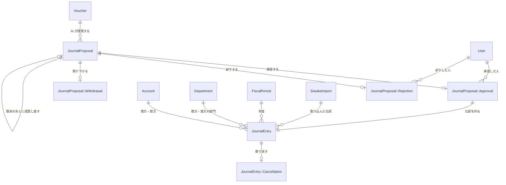
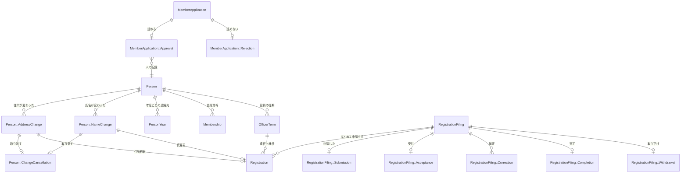
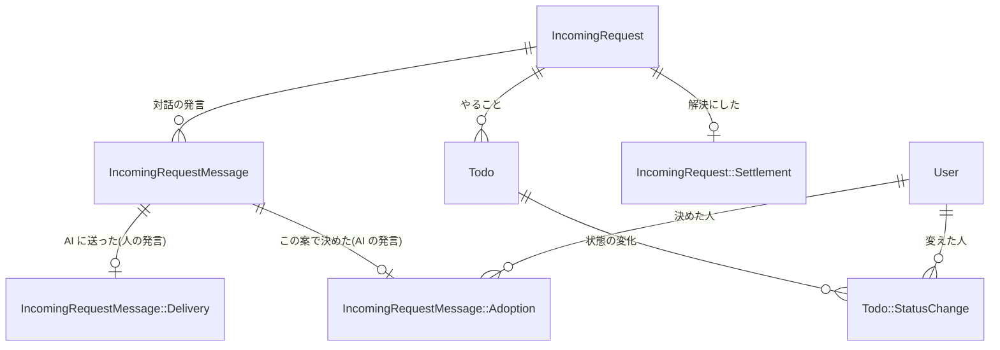
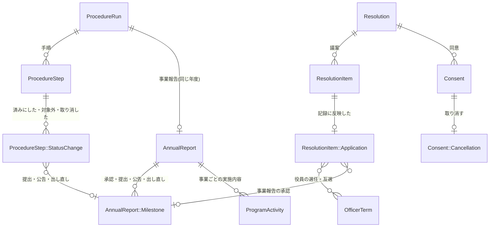

# データモデルの台帳

n-bato のすべてのモデルの、和名・英名・分類・日時の列を並べる。設計の考え方は ADR-0002〜0007(`docs/adr/`)。
モデルを足したら、この台帳にも足す(`test/models/data_model_ledger_test.rb` が、全モデルが載っていることと分類を確かめる)。

## 分類

| 記号 | 分類 | 意味 |
|---|---|---|
| R | リソース | もの(誰・何・いつ・どこ)。「〜する」を付けると不自然。業務として意味のある変更はイベントにする(ADR-0006) |
| LE | 長いイベント | 始まりと終わりのある出来事。中の詳細のイベントを足していき、自分は「いまの状態」だけを持つ(ADR-0005) |
| E | イベント | 出来事(なぜ・どうやって)。日時は 1 つ、追加するだけ(ADR-0003)。EventRecord を含む |
| 交差 | 交差エンティティ | どちらがなくても成り立つもの同士を結ぶ(人と年度、人と役) |
| システム | システム | 業務の外の仕組み(操作履歴・ログインのセッション) |

「移行」の列: **済** はこの考え方に沿って作り直したもの。**待** はまだで、移す順(会計 → 会員 → やること・依頼 → 手続き・決議・提出・登記)に沿って作り直す。

## 一覧

日時の列: イベントは出来事の日時(1 つ)。ほかの日付の列は、中身の日付(例: 仕訳の取引日)か、移行のときにイベントへ分ける列。

| 英名 | 和名 | 分類 | 単一性(何が 1 つか) | 同一性(同じと言えるとき) | カテゴリ | 日時の列 | 移行 |
|---|---|---|---|---|---|---|---|
| Account | 科目 | R | 年度ごとの科目 1 つ | 年度と科目コードが同じ | 会計王の科目(資産〜法人税等) | — | 待 |
| AnnualReport | 事業報告書の提出 | LE | 1 年度の事業報告書等 | 年度が同じ | 所轄庁に出す年に一度の報告。いまの状態(approved_on・submitted_on・bs_published_on・resubmit_needed_on・resubmitted_on)は節目の種類ごとの最後の記録から決まり、直接は書き換えない(docs/adr/0038) | letter_date(提出書の日付)は中身の日付 | 済 |
| AnnualReport::Milestone | 事業報告の節目 | E | 1 回の日付の記録 | — | 総会で承認した・提出した・公告した・出し直しが要る(決まりで。automatic)・出し直した。dated_on が空なら日付を消した。事業報告の画面・手順・決議の反映から記録する | recorded_at(中身の日付: dated_on) | 済 |
| ArticleVersion | 定款の版 | R | 総会で決めた 1 つの版 | 版の番号が同じ | 定款(全文) | decided_on(決めた日。版を作る出来事の日付) | 待 |
| AuditChange | 変更の記録 | システム | 1 つの記録の 1 回の変化 | — | 操作履歴 | — | — |
| AuditOperation | 操作 | システム | 1 回のリクエストの操作 | — | 操作履歴(元に戻す・やり直す) | — | — |
| BalanceCheck | 残高の確認 | E | ある日の 1 科目の確認 | — | 通帳・現金と帳簿の照合 | checked_on | 待 |
| Consent | 同意 | E | 1 人の 1 つの決議への同意 | 決議と人が同じ(取り消していないものは 1 つ) | 書面決議の同意。取り消しても消さない(docs/adr/0038) | consented_on | 済 |
| Consent::Cancellation | 同意の取消 | E | 1 つの同意の取消 | 同意が同じ(1 つに 1 つ) | 打ち間違いのときは取り消して記録し直す。取り消した同意は成立に数えない | cancelled_at | 済 |
| Department | 部門 | R | 年度ごとの部門 1 つ | 年度と部門コードが同じ | 事業①〜⑨・管理 | — | 待 |
| FiscalPeriod | 年度 | R | 4/1〜3/31 の 1 年 | 開始年が同じ | 事業年度 | 締めた日(「年度を締める」イベントへ分ける) | 待 |
| IncomingRequest | 依頼 | LE | 外から届いた 1 つの依頼 | — | メール・郵便などの依頼。いまの状態(status・resolved_on)は「解決にした」から決まる(docs/adr/0034) | received_on(届いた日)・due_on(期限)は中身の日付 | 済 |
| IncomingRequest::Settlement | 依頼の解決 | E | 1 つの依頼の解決 | 依頼が同じ(1 つに 1 つ) | やることが全部済んで解決にした(済んでいなくても解決にするときは force)。元に戻せる | settled_on | 済 |
| IncomingRequestMessage | 依頼の対話の発言 | E | 1 回の発言 | — | 人・AI の発言。人の発言は送るまで下書き(下書きだけは消せる。docs/adr/0034) | written_at | 済 |
| IncomingRequestMessage::Delivery | 依頼の対話を AI に送った | E | 1 つの人の発言の送信 | 発言が同じ(1 つに 1 つ) | 伏せた文と、添付を送ったか。AI の返事の発言も同じときに書く | delivered_at | 済 |
| IncomingRequestMessage::Adoption | AI の案を決めた | E | 1 つの AI の発言の案の決定 | 発言が同じ(1 つに 1 つ) | 「この案で決める」。依頼の中身を直し、やることを作り、状態を変える。元に戻せる | adopted_at | 済 |
| JournalEntry | 仕訳 | E | 1 件の取引(借方・貸方とも 1 科目) | 伝票番号と行番号 | 会計王の仕訳・承認でできた仕訳 | entry_date(取引日)。approved_at は承認のイベントへ移す | 待 |
| JournalEntry::Cancellation | 仕訳の取消 | E | 1 件の仕訳の取消 | 仕訳が同じ(1 仕訳に 1 つ) | 記帳した仕訳の誤りを取り消す(理由は必須。docs/adr/0026) | cancelled_at | 済 |
| JournalProposal | AI の仕訳の提案 | E | 証憑から AI が出した 1 件の仕訳の案 | — | AI の提案(Claude API・Claude Code)・取消のあとの提案のし直し(reproposed_from) | proposed_at(中身の日付: entry_date) | 済 |
| JournalProposal::Approval | 提案の承認(記帳) | E | 1 つの提案の承認 | 提案が同じ(1 提案に 1 つ) | 人が承認して仕訳にする | approved_at | 済 |
| JournalProposal::Rejection | 提案の却下 | E | 1 つの提案の却下 | 提案が同じ(1 提案に 1 つ) | 人が却下する | rejected_at | 済 |
| JournalProposal::Withdrawal | 提案の取り下げ | E | 1 つの提案の取り下げ | 提案が同じ(1 提案に 1 つ) | AI に提案をやり直させたとき | withdrawn_at | 済 |
| MemberApplication | 入会 | LE | 1 人の 1 回の入会の申込から決定まで | 申込の出どころのキー | フォームなどからの入会申込。いまの状態(status・人・年度・入会日・決めた日・理由)は認めた・認めないのイベントから決まる(docs/adr/0030) | applied_on(申し込んだ日) | 済 |
| MemberApplication::Approval | 入会を認めた | E | 1 つの申込の承認 | 申込が同じ(1 申込に 1 つ) | 人の記録と正会員の資格を作る | approved_at | 済 |
| MemberApplication::Rejection | 入会を認めなかった | E | 1 つの申込の不承認 | 申込が同じ(1 申込に 1 つ) | 理由は必須(定款第7条第4項) | rejected_at | 済 |
| Membership | 会員資格 | 交差 | 1 人の 1 年度の会員資格 | 人と年度が同じ | 正会員・活動会員など | 入会日・会費を納めた日(会費の納入はイベントへ。会費の画面ができるとき。docs/adr/0030) | 待 |
| OfficerTerm | 役員の任期 | 交差 | 1 人の 1 つの役の 1 期 | 人・役・始まりが同じ | 理事・監事・理事長・副理事長。代表権のある任期ができると登記の事由を作る | starts_on・ends_on は中身の日付(選ばれた任期)。退任(left_on)はイベントへ(退任の画面ができるとき。docs/adr/0030) | 待 |
| OpeningBalance | 期首残高 | R | 1 年度の 1 科目の繰越額 | 年度と科目が同じ | 仕訳より前の年度の繰越 | — | 待 |
| Organization | 法人 | R | 利用団体 1 つ | — | 法人 | 設立日(中身の日付) | 待 |
| FilingDestination | 提出先 | R | 書類を出す 1 つの窓口 | 種類と機関が同じ | 所轄庁・法人住民税(県・市)・登記・税務署・その他(docs/adr/0027) | — | 済 |
| FilingDestination::Confirmation | 提出先の確認 | E | 1 回の確認 | — | 人が中身を確かめた(確かめた中身の要約 digest を持つ。直すと確認済みでなくなる) | confirmed_at | 済 |
| FilingDestinationSearch | 提出先の調べもの | LE | AI に頼んだ 1 回の調べもの | — | 所在地から窓口を Web で調べる(docs/adr/0028)。いまの状態は status | requested_at | 済 |
| OrganizationYear | 法人の年度ごとの記録 | R | 1 年度の法人の情報(世代) | 年度が同じ | 名称・所在地などの年度ごとの値 | — | 待 |
| Passkey | パスキー | R | 1 つの端末の鍵 | 認証器の ID | ログインの手段 | last_used_at(使ったことの記録。ログインのたびに増えるので履歴は残さない) | 待 |
| Person | 人 | R | 1 人 | — | 会員・役員・関係者。氏名・よみ・住所の列は記録の始まりの値(打ち間違いは直してよい)。いまの値・ある日の値は出来事から(docs/adr/0029) | — | 済 |
| Person::AddressChange | 住所の変更 | E | 1 人の 1 回の転居 | — | 住所が変わった。日の分かり方(日・月・年度)を持つ。代表権のある理事なら登記の事由を作る | moved_on | 済 |
| Person::NameChange | 氏名の変更 | E | 1 人の 1 回の改姓・改名 | — | 氏名が変わった。変わる前の氏名・旧氏の併記を持つ。代表権のある理事なら登記の事由を作る | changed_on | 済 |
| Person::ChangeCancellation | 住所・氏名の出来事の取消 | E | 1 つの出来事の取消 | 出来事が同じ(1 つに 1 つ) | 打ち間違いのとき。いちばん新しい出来事だけ。理由は必須 | cancelled_at | 済 |
| PersonYear | 人の年度ごとの記録 | R | 1 人の 1 年度のメール・電話・メモ(世代) | 人と年度が同じ | 年度ごとの連絡先。氏名・住所は持たない(docs/adr/0029) | — | 済 |
| ProcedureRun | 手続き | LE | 1 年度の 1 つの年に一度の手続き | 手続きの種類と年度が同じ | 事業報告・役員の改選など。始めるのは start!。いまの状態(済んだ数・次にやること)は手順から毎回決まる(docs/adr/0038) | — | 済 |
| ProcedureStep | 手続きの手順の記録 | LE | 1 つの手続きの 1 つの手順 | 手続きと手順の種類が同じ | 確かめたこと・メモは作業の中身(ふつうに直してよい)。保存する状態(status・completed_on)は最後の状態の変化から決まり、直接は書き換えない(docs/adr/0038) | — | 済 |
| ProcedureStep::StatusChange | 手順の状態の変化 | E | 1 回の状態の変化 | — | 済みにした(済んだ日)・対象外にした(理由)・済みを取り消した。final の手順を済みにするのは元に戻せない。ほかは元に戻せる | changed_at(中身の日付: completed_on) | 済 |
| ProgramActivity | 事業の実施内容 | R | 1 年度の 1 事業の実施内容 | 事業報告書と部門が同じ | 事業報告書の事業ごとの記載。事業報告の中身なので、ふつうに直してよい(ADR-0006。docs/adr/0038) | — | 済 |
| ProgramProfile | 事業の主な活動 | R | 1 つの事業の主な活動 | 部門コードが同じ | 定款の事業(年度によらない) | — | 待 |
| Registration | 登記の事由 | LE | 1 つの登記の事由から登記まで | 任期・住所の変更・氏名の変更が同じ | 理事の重任・就任・住所の変更・氏名の変更。どの申請に入れたかと、登記した日(いまの状態。申請の完了で決まる)を持つ(docs/adr/0031) | cause_on(原因の日)・due_on(期限。日が不明なら空) | 済 |
| RegistrationFiling | 登記の申請 | LE | 法務局への 1 回の申請 | — | 登記の事由をまとめて申請する。いまの状態は詳細のイベントから(docs/adr/0031) | — | 済 |
| RegistrationFiling::Submission | 登記を申請した | E | 1 つの申請の送信 | 申請が同じ(1 つに 1 つ) | 申請番号(到達のお知らせ) | submitted_on | 済 |
| RegistrationFiling::Acceptance | 登記の申請の受付 | E | 1 つの申請の受付 | 申請が同じ(1 つに 1 つ) | 受付番号(受付のお知らせ) | accepted_on | 済 |
| RegistrationFiling::Correction | 登記の申請の補正 | E | 1 回の補正の求め | — | 法務局から求められたこと | noticed_on | 済 |
| RegistrationFiling::Completion | 登記の完了 | E | 1 つの申請の完了 | 申請が同じ(1 つに 1 つ) | 登記の事由を登記したにし、待っていたやることを作業中に戻す | completed_on | 済 |
| RegistrationFiling::Withdrawal | 登記の申請の取下げ | E | 1 つの申請の取下げ | 申請が同じ(1 つに 1 つ) | 理由は必須。登記の事由は新しい申請に入れ直せる | withdrawn_on | 済 |
| Resolution | 決議 | LE | 1 つの総会・理事会の決議 | — | 総会・理事会(書面決議を含む)。成立した日は取り消していない同意から毎回決まる。同意を記録した・議案を反映した決議は消せない(docs/adr/0038) | proposed_on(提案した日)・held_on(開いた日)は中身の日付 | 済 |
| ResolutionItem | 決議の議案 | R | 1 つの議案 | — | 役員の選任・事業報告の承認など。決議の中身。反映した議案は消せない | — | 済 |
| ResolutionItem::Application | 議案の反映 | E | 1 つの議案の反映 | 議案が同じ(1 つに 1 つ) | 成立した決議の内容を記録(役員の任期・登記の事由・事業報告の承認)へ反映した。元に戻せない操作 | applied_on | 済 |
| Session | ログインのセッション | システム | 1 回のログイン | — | ログイン | verified_at(本人を確かめ直した日時) | — |
| SiwakeImport | 仕訳の取り込み | E | 1 回の会計王のファイルの取り込み | — | 会計王の SIWAKE ファイル | exported_at(ファイルを書き出した日時) | 待 |
| SlackPost | Slack への送信 | E | 1 回の送信 | — | 期限のリマインド・記録の知らせ | posted_at | 待 |
| Todo | やること | LE | 1 つのやること | — | 依頼から作ったやること。いまの状態(status・waiting_on・done_at・done_by・done_note)は最後の状態の変化から決まり、直接は書き換えない(docs/adr/0034) | due_on(期限)は中身の日付 | 済 |
| Todo::StatusChange | やることの状態の変化 | E | 1 回の状態の変化 | — | 作業中にした・待ちにした・済みにした・未着手に戻した。決まりで変えたときは automatic。元に戻せる | changed_at | 済 |
| User | 利用者 | R | ログインする 1 人 | メールアドレスが同じ | 事務・監査 | — | 待 |
| Voucher | 証憑の処理 | LE | 1 つの証憑(領収書・請求書など)の受け取りから記帳まで | — | 領収書・通帳・請求書・メモ | issued_on(中身の日付)。いまの状態は提案のイベントから決まる | 済 |

## 用語辞書(画面の言葉 ↔ モデル)

| 画面の言葉 | モデル | メモ |
|---|---|---|
| 証憑・AI 仕訳 | Voucher・JournalProposal | |
| この内容で承認して記帳 | JournalProposal::Approval.approve! | 元に戻せない操作 |
| 却下 | JournalProposal::Rejection.reject! | 元に戻せない操作 |
| (AI に提案をやり直させる) | JournalProposal::Withdrawal.withdraw! | 前の確認待ちの提案を取り下げる |
| 記帳しない | Voucher(status = rejected) | 長いイベントのいまの状態 |
| 仕訳 | JournalEntry | |
| 取り消す(この仕訳を取り消す) | JournalEntry::Cancellation.cancel! | 元に戻せない操作。証憑から記帳した仕訳なら JournalProposal.repropose! で確認待ちの提案をもう一度作る |
| 取り消した仕訳も出す | JournalEntry.cancelled | ふだんの表・帳簿は JournalEntry.active |
| 年度 | FiscalPeriod | 開始年で表す(2024 年度 = 2024-04-01〜2025-03-31) |
| 科目・部門 | Account・Department | 年度ごと |
| やること | Todo・IncomingRequest | |
| 作業中にする・待ち・済みにする・未着手に戻す | Todo::StatusChange.change! | 元に戻せる。いまの状態と同じなら何もしない |
| (自動で済み・登記の完了で作業中に戻る) | Todo.refresh_auto!・Todo.resume! | 中で Todo::StatusChange.change!(automatic: true) |
| 全部済みました。依頼を解決にする | IncomingRequest::Settlement.settle! | 元に戻せる |
| AI に送る | IncomingRequestMessage::Delivery.deliver! | AI を呼ぶのは Requests::Organizer。返事が来てから記録する |
| この案で決める | IncomingRequestMessage::Adoption.adopt! | 元に戻せる |
| 入会申込 | MemberApplication | |
| 設定 › 提出先 | FilingDestination | 年度に依存しない。書類の宛先・手続きの説明の {所轄庁} は確認済みの所轄庁から |
| この内容で確認済みにする | FilingDestination::Confirmation.confirm! | 中身を直すと確認済みでなくなる |
| AI に調べてもらう | FilingDestinationSearch.request! | 送るのは所在地と法人の種類だけ。見つけたものは「AI の案」 |
| はじめに(最初の起動のウィザード) | Organization・FilingDestination | 法人が無いときホームから移る |
| 定款と事業 | ArticleVersion・ProgramProfile | |
| ログインのしかた | Passkey | |
| 手続き(この手順を済みにする・対象外にする・済みを取り消す) | ProcedureStep::StatusChange.change! | final の手順は元に戻せない。ほかは元に戻せる。同じ状態なら何もしない |
| 手続きを始める | ProcedureRun.start! | もう始めてあれば、その手続き |
| 事業報告の 総会で承認した日・提出した日・公告した日 | AnnualReport::Milestone.record! | 手順を済みにしたとき・決議の反映でも記録する。締めた年度を直すと「出し直しが要る」(automatic) |
| 同意を記録・取り消す | Consent.record!・Consent::Cancellation.cancel! | 取り消しても同意の記録は残る。成立に数えるのは Resolution#consents(取り消していないもの) |
| 記録に反映する(決議の議案) | ResolutionItem::Application.apply! | 元に戻せない操作 |
| 住所が変わった・氏名が変わった | Person::AddressChange.record!・Person::NameChange.record! | 元に戻せない操作。打ち間違いは Person::ChangeCancellation.cancel!(いちばん新しい出来事だけ) |
| 住所・氏名の移り変わり | Person#history | 名簿・届出書・登記は Person#address_on・display_name_on(その日の値) |
| 入会を認める・認めない | MemberApplication::Approval.approve!・MemberApplication::Rejection.reject! | 元に戻せない操作(ADR-0007) |
| 登記がいること | Registration | 年度に依存しない |
| 選んだもので登記の申請を始める | RegistrationFiling.start! | 書類を作っている間は、登記することを足す・外す(include!・exclude!) |
| 申請した・受付・補正・完了・取り下げ | RegistrationFiling::Submission.submit! ほか | 元に戻せない操作 |
| 登記すべき事項 | RegistrationFiling::Statement | 法務局の記載例に合わせて記録から作る |
| 登記・供託オンライン申請システム | RegistrationOnline | URL と使える時間は config/registration_online.yml |

## 会計の ER 図

- 証憑(LE)のいまの状態: 確認待ちの提案があれば「提案あり」、なければ承認があれば「記帳済み」、どちらもなければ「未処理」。AI の作業中・エラー・記帳しない は、提案のイベントからは決まらないのでそのまま持つ。照合は `bin/rails model:verify`。
- 承認でできた仕訳は消さない。記帳したあとの訂正は、取消の仕訳と正しい仕訳で行う(ADR-0007。仕訳の表の画面での訂正の仕方は、見直し票で合意してから作る)。

## 会員と登記の ER 図

- 人の住所・氏名: いまの値 = 取り消していない最後の出来事(無ければ記録の始まり)。日が分からない出来事は、分かっている範囲の初めの日(月の 1 日・年度の 4/1)と精度を持ち、推測で日を埋めない。登記すべき事項では「日が不明」と出す。
- 登記の申請のいまの状態: 取下げ → 完了 → 補正 → 受付 → 申請 の順にイベントがあるかで決まる。照合は `bin/rails model:verify`(登記の事由の登記した日・入会申込の状態・氏名の出来事のつながりも)。

## やること・依頼の ER 図

- やることのいまの状態: 最後の状態の変化(changed_at・id の順)の状態。変化が無ければ未着手。待ちなら待つもの、済みなら済んだ日時・ひとこと・自動かどうかも、その変化から。照合は `bin/rails model:verify`。
- 依頼のいまの状態: 「解決にした」があれば解決(解決した日はその日付)、無ければ進行中。
- 状態の変化・解決・案の決定は、ふつうの操作なので元に戻せる(元に戻すと、そのイベントも消える。docs/adr/0034)。

## 手続き・決議・提出の ER 図

- 手順の保存する状態: 最後の状態の変化(id の順)の状態と済んだ日。変化が無ければ open。画面の状態(未着手・進行中・待ち・期限切れ・記録から済み)は、これと確かめたこと・事業報告の日付から毎回計算する。照合は `bin/rails model:verify`。
- 事業報告のいまの状態: 節目の種類ごとに、最後の記録(id の順)の日付。照合は `bin/rails model:verify`。
- 決議の成立: 書面決議は、議決権を持つ全員の取り消していない同意がそろった日。取り消していない同意は 1 人 1 つ(model:verify でも確かめる)。
