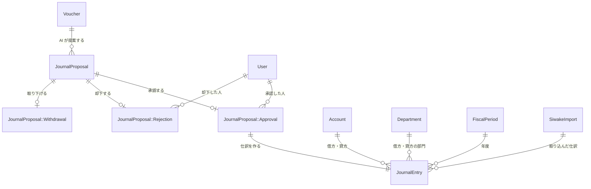

# データモデルの台帳

n-bato のすべてのモデルの、和名・英名・分類・日時の列を並べる。設計の考え方は ADR-0002〜0007(`docs/adr/`)。
モデルを足したら、この台帳にも足す(`test/models/data_model_ledger_test.rb` が、全モデルが載っていることと分類を確かめる)。

## 分類

| 記号 | 分類 | 意味 |
|---|---|---|
| R | リソース | もの(誰・何・いつ・どこ)。「〜する」を付けると不自然。業務として意味のある変更はイベントにする(ADR-0006) |
| LE | 長いイベント | 始まりと終わりのある出来事。中の詳細のイベントを足していき、自分は「いまの状態」だけを持つ(ADR-0005) |
| E | イベント | 出来事(なぜ・どうやって)。日時は 1 つ、追加するだけ(ADR-0003)。EventRecord を含む |
| 交差 | 交差エンティティ | どちらがなくても成り立つもの同士を結ぶ(人と年度、人と役) |
| システム | システム | 業務の外の仕組み(操作履歴・ログインのセッション) |

「移行」の列: **済** はこの考え方に沿って作り直したもの。**待** はまだで、移す順(会計 → 会員 → やること・依頼 → 手続き・決議・提出・登記)に沿って作り直す。

## 一覧

日時の列: イベントは出来事の日時(1 つ)。ほかの日付の列は、中身の日付(例: 仕訳の取引日)か、移行のときにイベントへ分ける列。

| 英名 | 和名 | 分類 | 単一性(何が 1 つか) | 同一性(同じと言えるとき) | カテゴリ | 日時の列 | 移行 |
|---|---|---|---|---|---|---|---|
| Account | 科目 | R | 年度ごとの科目 1 つ | 年度と科目コードが同じ | 会計王の科目(資産〜法人税等) | — | 待 |
| AnnualReport | 事業報告書の提出 | LE | 1 年度の事業報告書等 | 年度が同じ | 所轄庁に出す年に一度の報告 | 承認・提出・公告の日付(詳細のイベントへ分ける) | 待 |
| ArticleVersion | 定款の版 | R | 総会で決めた 1 つの版 | 版の番号が同じ | 定款(全文) | decided_on(決めた日。版を作る出来事の日付) | 待 |
| AuditChange | 変更の記録 | システム | 1 つの記録の 1 回の変化 | — | 操作履歴 | — | — |
| AuditOperation | 操作 | システム | 1 回のリクエストの操作 | — | 操作履歴(元に戻す・やり直す) | — | — |
| BalanceCheck | 残高の確認 | E | ある日の 1 科目の確認 | — | 通帳・現金と帳簿の照合 | checked_on | 待 |
| Consent | 同意 | E | 1 人の 1 つの決議への同意 | — | 書面決議の同意 | consented_on | 待 |
| Department | 部門 | R | 年度ごとの部門 1 つ | 年度と部門コードが同じ | 事業①〜⑨・管理 | — | 待 |
| FiscalPeriod | 年度 | R | 4/1〜3/31 の 1 年 | 開始年が同じ | 事業年度 | 締めた日(「年度を締める」イベントへ分ける) | 待 |
| IncomingRequest | 依頼 | LE | 外から届いた 1 つの依頼 | — | メール・郵便などの依頼 | 受け取った日・期限・解決した日 | 待 |
| IncomingRequestMessage | 依頼の対話の発言 | E | 1 回の発言 | — | 人・AI の発言 | 送った日時・決めた日時(分ける) | 待 |
| JournalEntry | 仕訳 | E | 1 件の取引(借方・貸方とも 1 科目) | 伝票番号と行番号 | 会計王の仕訳・承認でできた仕訳 | entry_date(取引日)。approved_at は承認のイベントへ移す | 待 |
| JournalProposal | AI の仕訳の提案 | E | 証憑から AI が出した 1 件の仕訳の案 | — | AI の提案(Claude API・Claude Code) | proposed_at(中身の日付: entry_date) | 済 |
| JournalProposal::Approval | 提案の承認(記帳) | E | 1 つの提案の承認 | 提案が同じ(1 提案に 1 つ) | 人が承認して仕訳にする | approved_at | 済 |
| JournalProposal::Rejection | 提案の却下 | E | 1 つの提案の却下 | 提案が同じ(1 提案に 1 つ) | 人が却下する | rejected_at | 済 |
| JournalProposal::Withdrawal | 提案の取り下げ | E | 1 つの提案の取り下げ | 提案が同じ(1 提案に 1 つ) | AI に提案をやり直させたとき | withdrawn_at | 済 |
| MemberApplication | 入会 | LE | 1 人の 1 回の入会の申込から決定まで | 申込の出どころのキー | フォームなどからの入会申込 | 申込・入会・決めた日(詳細のイベントへ分ける) | 待 |
| Membership | 会員資格 | 交差 | 1 人の 1 年度の会員資格 | 人と年度が同じ | 正会員・活動会員など | 入会日・会費を納めた日(会費の納入はイベントへ) | 待 |
| OfficerTerm | 役員の任期 | 交差 | 1 人の 1 つの役の 1 期 | 人・役・始まりが同じ | 理事・監事・理事長・副理事長 | 始まり・終わり・退任(就任・退任はイベントへ) | 待 |
| OpeningBalance | 期首残高 | R | 1 年度の 1 科目の繰越額 | 年度と科目が同じ | 仕訳より前の年度の繰越 | — | 待 |
| Organization | 法人 | R | 利用団体 1 つ | — | 法人 | 設立日(中身の日付) | 待 |
| OrganizationYear | 法人の年度ごとの記録 | R | 1 年度の法人の情報(世代) | 年度が同じ | 名称・所在地などの年度ごとの値 | — | 待 |
| Passkey | パスキー | R | 1 つの端末の鍵 | 認証器の ID | ログインの手段 | last_used_at(使ったことの記録。ログインのたびに増えるので履歴は残さない) | 待 |
| Person | 人 | R | 1 人 | — | 会員・役員・関係者 | — | 待 |
| PersonYear | 人の年度ごとの記録 | R | 1 人の 1 年度の住所・氏名など(世代) | 人と年度が同じ | 名簿の年度ごとの値 | — | 待 |
| ProcedureRun | 手続き | LE | 1 年度の 1 つの年に一度の手続き | 手続きの種類と年度が同じ | 事業報告・役員の改選など | — | 待 |
| ProcedureStep | 手続きの手順の記録 | E | 1 つの手続きの 1 つの手順 | 手続きと手順の種類が同じ | 済み・対象外・確かめたこと | completed_on | 待 |
| ProgramActivity | 事業の実施内容 | R | 1 年度の 1 事業の実施内容 | 事業報告書と部門が同じ | 事業報告書の事業ごとの記載 | — | 待 |
| ProgramProfile | 事業の主な活動 | R | 1 つの事業の主な活動 | 部門コードが同じ | 定款の事業(年度によらない) | — | 待 |
| Registration | 登記 | LE | 1 つの登記の事由から登記まで | — | 役員の変更・資産の総額など | 事由の日・期限・登記した日(分ける) | 待 |
| Resolution | 決議 | LE | 1 つの総会・理事会の決議 | — | 総会・理事会(書面決議を含む) | 提案した日・開いた日 | 待 |
| ResolutionItem | 決議の議案 | E | 1 つの議案 | — | 役員の選任・事業報告の承認など | applied_on(記録へ反映した日) | 待 |
| Session | ログインのセッション | システム | 1 回のログイン | — | ログイン | verified_at(本人を確かめ直した日時) | — |
| SiwakeImport | 仕訳の取り込み | E | 1 回の会計王のファイルの取り込み | — | 会計王の SIWAKE ファイル | exported_at(ファイルを書き出した日時) | 待 |
| SlackPost | Slack への送信 | E | 1 回の送信 | — | 期限のリマインド・記録の知らせ | posted_at | 待 |
| Todo | やること | LE | 1 つのやること | — | 依頼から作ったやること | 期限・済んだ日時(状態の変化はイベントへ) | 待 |
| User | 利用者 | R | ログインする 1 人 | メールアドレスが同じ | 事務・監査 | — | 待 |
| Voucher | 証憑の処理 | LE | 1 つの証憑(領収書・請求書など)の受け取りから記帳まで | — | 領収書・通帳・請求書・メモ | issued_on(中身の日付)。いまの状態は提案のイベントから決まる | 済 |

## 用語辞書(画面の言葉 ↔ モデル)

| 画面の言葉 | モデル | メモ |
|---|---|---|
| 証憑・AI 仕訳 | Voucher・JournalProposal | |
| この内容で承認して記帳 | JournalProposal::Approval.approve! | 元に戻せない操作 |
| 却下 | JournalProposal::Rejection.reject! | 元に戻せない操作 |
| (AI に提案をやり直させる) | JournalProposal::Withdrawal.withdraw! | 前の確認待ちの提案を取り下げる |
| 記帳しない | Voucher(status = rejected) | 長いイベントのいまの状態 |
| 仕訳 | JournalEntry | |
| 年度 | FiscalPeriod | 開始年で表す(2024 年度 = 2024-04-01〜2025-03-31) |
| 科目・部門 | Account・Department | 年度ごと |
| やること | Todo・IncomingRequest | |
| 入会申込 | MemberApplication | |
| 定款と事業 | ArticleVersion・ProgramProfile | |
| ログインのしかた | Passkey | |

## 会計の ER 図

- 証憑(LE)のいまの状態: 確認待ちの提案があれば「提案あり」、なければ承認があれば「記帳済み」、どちらもなければ「未処理」。AI の作業中・エラー・記帳しない は、提案のイベントからは決まらないのでそのまま持つ。照合は `bin/rails model:verify`。
- 承認でできた仕訳は消さない。記帳したあとの訂正は、取消の仕訳と正しい仕訳で行う(ADR-0007。仕訳の表の画面での訂正の仕方は、見直し票で合意してから作る)。
