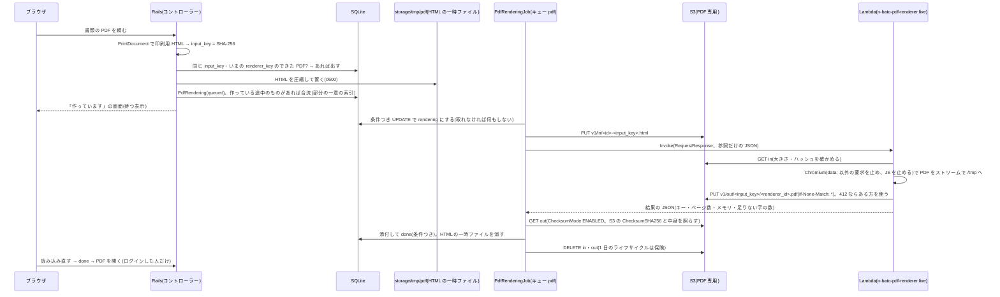

# 基本設計: PDF を AWS Lambda で作る(#22)

- 状態: 決定(開発QAボード 第9回 `r9-adr0037`、2026-11-25。敵対的なレビュー 1 回目を反映した。対応の表は最後の「レビューへの対応」)。決定の要約は [ADR-0037](../adr/0037-pdf-on-lambda.md)。
- 決まったこと(前提): Issue #22 のコメント「決まったこと: 開発QAボード 第7回」(2026-11-24、理事長)。5 問とも AI のおすすめ。
  - 7-1 `lambda`: Lambda(Chromium と日本語のフォントを入れたコンテナ)で作り、Rails はジョブから頼む。
  - 7-2 `job-then-notify`: ジョブで作る。「作っています」→「開く」。できた PDF は添付として残す。元のデータが変わっていなければ残っている PDF を出す。ジョブの進み具合の画面は EPIC #23。
  - 7-3 `s3-short-lived`: HTML と PDF は PDF 専用の S3(暗号化・非公開)を通し、1 日で消す。ログに中身を書かない。Lambda の通信の上限に合うやりとりの決まり(プロトコル)を作る。
  - 7-4 `new-user`: PDF 専用の IAM ユーザー(ADR-0035)。
  - 7-5 `build-now-switch-safely`: いま作る。12/7 より前に切り替えられなければ 1 月。しばらく Chrome に戻せるスイッチを残す。**Lambda は強くする**(過去に「Chromium のメモリが 100MB を超えると止まる」「通信の失敗のやり直しが適切でない」ことがあった)。
  - **関数のメモリ(開発QAボード 第9回 `r9-adr0037`、2026-11-25、理事長)**: 「Lambda はなるべくメモリを少なくして、1GB か、できれば 500MB 程度か。ただ、Chromium を動かすので 1GB は必要かもしれない。実験して適切な値にして」。→ 4.2・4.10 ⑤・8.2 を直した(約 3008MB をやめ、1024MB から始めて、実験で決める)。
  - **過去の不具合の様子(開発QAボード 第8回 `r8-lambda-past`、2026-11-25、理事長。[Issue #22 のコメント](https://github.com/smalruby/n-bato/issues/22#issuecomment-7138129159))**: 「Chromium の設定で、使えるメモリの既定が 100MB 程度だったはず。環境変数かオプションで避けた。関数のメモリは 6GB の設定だったので、関数のメモリは原因ではない」。→ 4.1・4.10 ①・9 章を直した。
  - **方針の変更(2026-11-24、理事長)**: 12 月に止める期間はなくした(「改修はどんどんやって、問題があれば都度直す」)。受け入れの条件(8.2)が通ったらすぐ切り替え、手で Chrome に戻すスイッチは残す。
- 運用の手間を小さくする(理事長の方針)。部品と自動の切り替えを増やさず、手で戻せる形にする。
- この文書は設計だけ。コードはまだ書かない。

目次: 0. いまの形 / 1. 全体の形 / 2. プロトコル / 3. 素材と通信の禁止 / 4. 強さ / 5. Rails の側 / 6. AWS(CDK) / 7. テスト / 8. 切り替えの段取り・受け入れ・費用 / 9. 人に聞くこと / 10. 危ないこと・決めていないこと / 出どころ / レビューへの対応

---

## 0. いまの形(読んだコード)

- `app/models/pdf_renderer.rb`(PR #21 がマージ済み): `PdfRenderer.engine` で作り方を差し替える。`PdfRenderer::Chrome`(Ferrum、待ち時間 60 秒)と `PdfRenderer::Fake`(テスト用。渡された HTML を覚える)。`PdfRenderer.render(html)` はバイト列を返す。
- 呼ぶのは 6 つのコントローラーの `format.pdf`。どれも `render_to_string` で印刷用の HTML を作り、その場で `send_data`(同期)。

| コントローラー | アクション | テンプレート | ファイル名 |
|---|---|---|---|
| `FilingsController` | `show`(8 書類)・`pack`(一式) | `filings/documents` | `<年度>-<書類>.pdf` / `<年度>-pack.pdf` |
| `StatementsController` | `show`(計算書類の種類) | `statements/show` | `<年度>-<種類>.pdf` |
| `ResolutionsController` | `document`(提案書・同意書・議事録) | `resolutions/document` | `resolution-<id>-<書類>.pdf` |
| `RegistrationFilingsController` | `document`(内訳・互選書・定款) | `registration_filings/document` | `registration-<id>-<書類>.pdf` |
| `LedgersController` | `index`(総勘定元帳)・`show`(1 科目) | `ledgers/index` | `<年度>-ledger.pdf` |
| `FilingSamplesController` | `show`(様式の例。架空の法人) | `filings/documents` | `n-bato-forms-sample.pdf`(attachment) |

- 印刷用のレイアウト `layouts/print.html.erb` は **CSS を `<style>` に直に書き、画像・スクリプト・外のファイルを使わない**。フォントは名前で指定(`"Hiragino Mincho ProN", "Yu Mincho", "Noto Serif CJK JP", "MS Mincho", serif`)。本番のイメージ(Debian)では `fonts-noto-cjk` の Noto Serif CJK JP が使われる。`@pdf` のときはツールバー(リンク)を出さない。
- 本番: Lightsail 2GB、Solid Queue は Puma の中(`SOLID_QUEUE_IN_PUMA`、ワーカー 1 つ・3 スレッド・`queues: "*"`)。Chrome のための swap 2GB。Active Storage はサーバーのディスク(`:local`)。キューの名前は `default`(AI の調べもの・仕訳の提案・メール・定期のジョブ)と Active Storage のもの。

## 1. 全体の形



### 1.1 呼び方: ジョブから同期(RequestResponse)で呼ぶ

**採用: ジョブが `Invoke(InvocationType: RequestResponse)` で呼び、答えを待つ。** 非同期(Event)+ 結果を見に行く(ポーリング)は使わない。

- **やり直しの持ち主を 1 つにできる。** 非同期の呼び出しは、Lambda が失敗を既定で 2 回までやり直す([L-retry])。ジョブのやり直しと重なると二重・三重に作る。同期なら Lambda は自分ではやり直さない(同上)。
- **結果がすぐ分かる。** 非同期だと、結果を S3 に置く・ジョブが見に行く間隔・いつまで待つか、が増える。キューで何時間も待つこともある(同上)。
- **大きさの上限は問題にならない。** 同期は要求・応答とも 6MB、非同期は 1MB([L-quota]。以前の文書の 256KB から変わった)。HTML と PDF は S3 を通し、JSON は参照だけなので数 KB。
- 悪い点: ジョブのスレッドが Lambda の終わりまで(ふだん数秒、最大 90 秒)ふさがる。→ 同時に 2 つまで(5.5)。いまのワーカーの 3 スレッドのうち 1 つは必ず他のジョブに残る。
- 悪い点: 待っている間に通信が切れると、作り終えたか分からない。→ 出力の場所は入力と作り手で決まる名前にし、条件つきの書き込み(If-None-Match)で最初の 1 つだけを残す(4.5)。次の試みはそれを読む。

### 1.2 Lambda の中身(コンテナイメージ)

- ランタイム: Node.js 22(`public.ecr.aws/lambda/nodejs:22`、x86_64、**ダイジェスト(@sha256:…)で固定**)+ `puppeteer-core`(25.19.0)。**Chromium は Google の Chrome for Testing の `chrome-headless-shell`**(puppeteer-core が対応する版 158.0.8127.88)。zip は Dockerfile で落とし、**SHA-256 で固定**して確かめる。2 つの版は組にして固定する(puppeteer-core を上げるときは、その版が対応する Chromium に合わせて上げる)。
  - x86_64 にする理由: Chrome for Testing の Linux 版は x64 だけ。
  - **`@sparticuz/chromium` をやめた(P1、2026-11-27)**: 143・147・153・158 のどの版も、包みの勧めどおり(Lambda の素のイメージ・実行のときに /tmp へ展開・包みの旗)に立ち上げても、x86_64 の ubuntu(GitHub Actions)と Lambda のイメージで何も出さずに止まった(`--dump-dom` も `--print-to-pdf` も、20〜40 秒待って出ない)。同じ ubuntu の上で、Playwright の使う `chrome-headless-shell` は同じ旗ですぐ動いた。本物の Lambda では動くのかもしれないが、手元・CI で確かめられないものは使わない。
  - `chrome-headless-shell` が読む .so(nss・nspr・atk・dbus-libs・X11 の一部・mesa-libgbm・libxkbcommon・alsa-lib など)は、Amazon Linux 2023 の包みを `dnf` で入れる(足りないものは `ldd` で確かめた)。イメージは 1.2GB(Lambda の上限 10GB の中)。
- **Chromium はイメージの中に置いたまま使う**(`/opt/chromium/`)。動くときに /tmp へ展開しない。立ち上がりが速くなり、/tmp を使わない。
- **フォントは本番の Rails と同じファイル**: Dockerfile の段の 1 つを Rails の本番と同じ Debian にして `fonts-noto-cjk` を入れ、Noto Serif CJK・Noto Sans CJK(Regular・Bold)の `.ttc` を `/var/task/fonts/` に写す。fontconfig は自前の `fonts.conf`(`FONTCONFIG_FILE`)で `/var/task/fonts` だけを探し、キャッシュは `/tmp/fontconfig` に置く。`serif` は Noto Serif CJK JP、`sans-serif` は Noto Sans CJK JP に向ける。
  - 作るときに、フォントのファイルの SHA-256 をまとめた `font_digest` と、**フォントが持つ字の一覧を小さいファイル `coverage.txt` に書き出す**(`fc-query --format='%{charset}'`。4.9)。`font_digest` は応答の `renderer` に入れる。
  - `serif` の行き先が Noto 以外にならないことを、7.3 の `pdffonts` で守る(P1 の実験では、すべての PDF が `NotoSerifCJKjp-Regular`・`-Bold` だけを埋めた)。
- コードの置き場所: `lambda/pdf-renderer/`(`package.json`・`Dockerfile`・`src/handler.ts`・`schema/`・`config.json`・`test/`)。CDK は `infra/lib/pdf-renderer.ts`(6 章)。
- `lambda/pdf-renderer/config.json` に関数のメモリ・時間切れ・上限の数を 1 つだけ書き、CDK・Lambda・Rails のテストが同じものを読む(値がずれないように)。

## 2. プロトコル(Rails ⇔ Lambda)

### 2.1 S3 の置き場所(キー)

```
<PDF 専用のバケット>/
  v1/in/<rendering_id>-<input_key>.html          Rails が置く。Lambda が読む
  v1/out/<input_key>/<renderer_id>.pdf           Lambda が条件つきで置く(If-None-Match: *)。Rails が読んで消す
```

- `v1` はプロトコルの版。合わない変更をするときは `v2/` を足し、しばらく両方を読む。
- 入力のキーに `rendering_id` を入れる: ある記録の後片づけの DELETE が、同じ HTML の別の記録の入力を消さないように。
- 出力のキーは入力(`input_key`)と作り手(`renderer_id` = SHA-256(ビルドの名前 + `font_digest`) の先頭 16 文字。Lambda が自分で決める)で決まる。同じ入力・同じ作り手なら同じキーなので、二重に動いても条件つきの書き込みで最初の 1 つだけが残る。
- 氏名・日付・書類の名前はキーに入れない(キーはログや CloudTrail に出る)。

### 2.2 鍵: input_key と renderer_key

```
input_key    = SHA-256( "n-bato-pdf" \0 PROTOCOL_VERSION \0 RENDERER_GENERATION \0 canonical_json(options) \0 html_bytes )
renderer_key = engine ":" build ":" font_digest          (例 "lambda:2026.12.1-c153:9f2c…" / "chrome:<Chromium の版>:<フォントの digest>")
```

- **使い回すのは `input_key` と `renderer_key` の両方が同じ `done` だけ**。エンジン(切り替えの間)・Lambda のビルド・フォントが変われば、作り直す。
- `renderer_key` は、作るまで Rails には分からない。そこで「そのエンジンで最後にできた PDF の `renderer_key`」を **いまの作り手** とみなす(`PdfRendering.current_renderer_key(engine)`)。Lambda をデプロイしたあと、最初の 1 件ができるまでは前のビルドの PDF が使い回される。→ デプロイの手順に、架空の「様式の例」を 1 件作る確かめを入れる(8 章の P4・デプロイのたび)。これで新しいビルドが分かり、以後は作り直される。
- `RENDERER_GENERATION` は Rails の定数(整数)。テンプレートの外の理由で作り直したいときに人が上げる。
- `options` は `{ "format": "A4", "print_background": true, "prefer_css_page_size": true }`(いまの Ferrum の呼び方と同じ)。キーを並べた JSON。

### 2.3 JSON Schema は 1 か所に

- `lambda/pdf-renderer/schema/request.v1.json`・`response.v1.json`。どのオブジェクトも `additionalProperties: false`。
- Lambda のテストは ajv、Rails のテストは json_schemer で、同じファイルを使って確かめる。Rails は本番でも応答をこの形で確かめる(違えば `internal`)。

要求(要点):

| 項目 | 形 | 意味 |
|---|---|---|
| `protocol` | 1 | |
| `request_id` | `pdf-<id>-a<回数>` | ログの照合用。中身は入れない |
| `input_key` | 16 進 64 文字 | |
| `input` | `{bucket, key, sha256, bytes}` | key は `^v1/in/[0-9]+-[0-9a-f]{64}\.html$`、bytes ≤ 10MB |
| `output_prefix` | `v1/out/<input_key>/` | Lambda が `<renderer_id>.pdf` を足す |
| `options` | 2.2 | |
| `limits` | `{max_pages, max_output_bytes}` | 300・50MB(config.json) |
| `deadline_at` | UNIX ミリ秒 | 過ぎていたら作らずに `DEADLINE_EXCEEDED` |

- バケットとキーの形を Lambda の側でも確かめる。バケットは関数の環境変数と同じでなければ断る。
- 署名付き URL は使わない(URL そのものが鍵になり、要求に秘密が入る)。Lambda は自分のロールで読み書きする。

応答(要点):

| 項目 | 形 | 意味 |
|---|---|---|
| `protocol`・`request_id` | | |
| `status` | `ok` / `error` | |
| `reused` | bool | 条件つきの書き込みが 412 で、すでにあるものを返した |
| `output` | `{bucket, key, bytes, pages}` | ハッシュは入れない(Rails は S3 のオブジェクトのチェックサムで確かめる。4.5) |
| `error` | `{code, retryable, detail}` | code は 4.4 の表。`detail` は例外の種類の名前だけ(200 字まで) |
| `metrics` | `{cold_start, duration_ms, launch_ms, render_ms, upload_ms, peak_rss_mb, memory_limit_mb, tmp_free_mb, blocked_requests, missing_glyphs, missing_codepoints}` | `missing_codepoints` は `U+XXXX` の並びだけ(最大 50) |
| `renderer` | `{build, chromium, puppeteer, font_digest, renderer_id}` | |

- 分かっている失敗は、例外を投げずに `status: "error"` で返す。例外のまま終わる(Lambda の `FunctionError`)のは、予想していない失敗と、ランタイムが止めたとき(時間切れ・メモリ切れ)だけ。
- **ハンドラー全体を包む**: いちばん外で例外を受け、`INTERNAL`(`detail` は例外の種類の名前だけ)で返す。ランタイムに渡るのは、時間切れ・メモリ切れで包みの外で止まったときだけになる。Rails は `FunctionError` の本文(`errorMessage` など)をログにも記録にも書かない。種類(`Unhandled` かどうか)だけを使う。

### 2.4 暗号化・寿命・権限・ログ

- バケット: 公開をすべて止める・TLS だけ・SSE-S3(バックアップのバケットと同じ。KMS は使わない)・バージョニングなし(消したら本当に消え、If-None-Match も単純に効く)・ACL なし。
- 寿命: ライフサイクルで `v1/` を **1 日で消す**、**途中のマルチパートのアップロードを 1 日で消す**(AbortIncompleteMultipartUpload。[S3-cw] がすすめる)。ふだんは Rails が添付したすぐあとに in と out を消す。ライフサイクルの消去は期限のあと非同期に行われる(未確認。P3 の前に確かめる)。
- 権限: 6.3。
- **ログに中身を書かない**(7-3)。
  - Lambda: 要求の JSON をそのまま出さない(lint の決まりとテストで守る)。出すのは 1 行の JSON: `request_id`・`input_key` の先頭 12 文字・状態・エラーのコード・時間・ページ数・大きさ・メモリ・`missing_glyphs`。ページの `console`・`pageerror`・止めた要求の URL は出さない(数だけ)。ログの保存は 30 日。
  - Rails: ジョブの引数は `PdfRendering` だけ(HTML を引数にしない。Solid Queue は引数を DB に残す)。Lambda の応答・`FunctionError` の本文をログに出さない。`error_message` は 4.4 の表の文と `detail` だけ。

## 3. 素材(CSS・フォント・画像)と通信の禁止

### 3.1 素材の決まり: 印刷用の HTML は 1 つのファイルで完結させる

- CSS は `<style>` に直に書く(いまの `layouts/print` のまま)。
- 画像を入れるとき(これからの印影・ロゴなど)は `data:` の URI にする。そのための helper(例: `inline_image_tag`)を足す。大きい画像は Rails の側で縮める(HTML の上限 10MB)。
- スクリプトと外のフォントは使わない。フォントは名前で指定し、Lambda のイメージに入れたものを使う。
- **守り方**: `PdfRenderer::HtmlCheck` が、送る前に HTML を Nokogiri で見て、`data:` でない `src`・`href`(`<link>`)・CSS の `url(...)`・`@import` を数える。テストと開発では例外。本番では警告を 1 行(数だけ)出して続ける(Lambda で止まり、PDF から抜けるだけ)。

### 3.2 Lambda の中の通信の禁止

VPC には置かない(レビュー Q6。部品と運用の手間を増やさない)。守りは Chromium の中で行う。

1. **要求を止める**: Puppeteer の `page.setRequestInterception(true)` で、`data:` と `about:blank` 以外をすべて `abort()`。止めた数を `blocked_requests` に数える(URL は出さない)。
2. **JS を止める**: `page.setJavaScriptEnabled(false)`。
3. **旗**: `@sparticuz/chromium` の既定の旗のうち `--disable-web-security` と `--allow-running-insecure-content` を外す。使う旗の一覧をコードの定数にし、**一覧そのものをテストで固定する**(足し忘れ・外し忘れを見つける)。`--proxy-server`・`--host-resolver-rules` は足してもよいが、効くかは 7.4 で確かめてから(未確認)。
- 狙われうる先: Lambda の Runtime API(`127.0.0.1:9001`、`AWS_LAMBDA_RUNTIME_API`)・メタデータのアドレス・インターネット。7.4 の攻撃のテストにすべて入れる。
- 費用の守り: AWS Budgets の警報(月の見込みの数倍で、メール)と、同時に動く数の上限(Rails の側で 2。予約の同時実行は付けない。4.8)。

## 4. 強さ(この設計の柱)

### 4.1 過去の 2 つの不具合を、どう防ぐか

| 過去の不具合 | ありそうな原因(9 章。第8回の答えで絞った) | この設計での防ぎ方 |
|---|---|---|
| Chromium のメモリが 100MB を超えると止まる | **第一の候補: Chromium の側の上限**(第8回の答え「Chromium の設定で使えるメモリの既定が 100MB 程度。環境変数かオプションで避けた」)。どの上限かは未確認で、P1 の実験 ① で確かめる。候補は (a) 共有メモリ: `/dev/shm` が無い・小さいのに `--disable-dev-shm-usage` が付いていない、(b) V8 のヒープの上限(`--js-flags=--max-old-space-size=…` などで変わる)、(c) `--single-process`(`@sparticuz/chromium` の既定)でレンダラとブラウザが 1 つのプロセスに入ることによる上限、(d) そのほかの起動の旗・環境変数。**関数のメモリは外した**(過去は 6GB の設定で、それでも止まった。第8回)。**次に安く守っておくもの**(原因でなくても守りになる): Puppeteer の WebSocket の `maxPayload`(100MiB)を PDF の base64 が超えた / 応答で PDF を返して 6MB の上限に当たった / `heapUsed`(JS のヒープ)だけを見ていて実際の RSS を見ていなかった / /tmp 512MB があふれた | Chromium の起動の旗は一覧の定数にしてテストで固定し(3.2)、メモリに効く旗(`--disable-dev-shm-usage`・`--js-flags`・`--single-process` の有無)は実験 ① の結果で決めて一覧に書く。メモリは 1024MB から始め、実験 ⑤ で 512MB まで下げられるかを確かめる(1 つの関数。4.2。関数のメモリは原因でなかった。第9回で「なるべく少なく」)。**PDF はストリームで /tmp に書き出す**(`page.createPDFStream()`、CDP の `transferMode: ReturnAsStream`)ので、WebSocket の 1 つのメッセージに PDF 全体が乗らない。PDF は S3 で渡し、応答には載せない。メモリは **REPORT の `Max Memory Used` を正**とし、RSS も測る。/tmp は 1024MB。P1 の実験 ①〜④(4.10)で原因の候補を 1 つずつ確かめる(① が第一の候補) |
| 通信に失敗したときのやり直しが適切でない | AWS の SDK の既定: Ruby の aws-sdk-core 3.272.0 は `retry_mode: standard`・`max_attempts: 3`(やり直し 2 回)、読み取りの待ち時間 60 秒(`http_read_timeout`)。`Net::ReadTimeout` は `Seahorse::Client::NetworkingError` に包まれ、やり直しの対象になる。Lambda が 60 秒を超えると同じ要求が送り直され、Chromium が並んで動く | Lambda のクライアントに **`retry_mode: "standard", max_attempts: 1` を明示する**(クライアントに渡した値は `AWS_RETRY_MODE`・`AWS_MAX_ATTEMPTS` の環境変数より強い)。**読み取りの待ち時間 100 秒 > 関数の時間切れ 90 秒**。この 2 つを Rails のテストで確かめる(7.6)。やり直すのはジョブだけ(4.4) |

### 4.2 メモリ

- **関数は 1 つ**(レビュー Q5)。**メモリはなるべく少なく**(開発QAボード 第9回): 1024MB から始め、P1 の実験 ⑤ で 512・768・1024・1536MB を比べ、6 つの書類とストレス(7.3)がすべて作れ、いちばん重いもののメモリの山が 50% 以下で、時間が関数の時間切れの半分以下に収まる **いちばん小さい値** にする。[SP] は最低 512MB・1600MB 以上をすすめる。Lambda は 1,769MB で vCPU 1 つ分になり、メモリを減らすと CPU も減って遅くなる([L-quota])ので、時間も見る。1024MB で条件を満たさなければ、測った表を付けて ADR-0037 を書き足し、PR で知らせる。新しいアカウントはメモリの上限が下げられていることがある([L-quota])ので、cdk deploy の前に上限を確かめる。重い入力のやり直しも同じ関数で 1 回だけ。
- `/tmp` は 1024MB。
- 測り方(毎回):
  - **正は Lambda の `REPORT` の行の `Max Memory Used`**(実行の環境まるごと。子のプロセスも入る)。CloudWatch Logs Insights で書類の種類ごとにまとめる。
  - 関数の中でも 100 ミリ秒ごとに、Chromium のプロセスの集まり(プロセスグループ)の各プロセスの `/proc/<pid>/status` の `VmRSS` と Node の `process.memoryUsage().rss` を足し、その最大を `peak_rss_mb` にして応答とログに入れる(`heapUsed` は使わない)。Rails は `PdfRendering#peak_memory_mb` に残す。REPORT との差は P1 の実験 ④ で確かめる。
  - Embedded Metric Format でメトリクス `PeakRssMb`・`DurationMs`・`Pages`・`MissingGlyphs` を出す。**`PeakRssMb` が関数のメモリの 50% を超えたら警報**(SNS でメール)。
- 切り替えの条件(8.2): 本番の実データで、**いちばん重い書類のメモリの山が関数のメモリの 50% 以下**。

### 4.3 時間切れ(外側ほど長く)

| 層 | 値 | 何が起きるか |
|---|---|---|
| Chromium: `setContent` | 15 秒(外を読まないので、ふだん 1 秒もかからない) | `RENDER_TIMEOUT` |
| Chromium: PDF のストリーム | Lambda の残り時間 **− 20 秒**(`context.getRemainingTimeInMillis()`)、上限 60 秒 | `RENDER_TIMEOUT`。片づけと S3 への PUT の 20 秒を残す |
| Lambda の中の S3 のクライアント | 1 回の要求の時間切れ(`requestTimeout`)と回数(`maxAttempts`)を残り時間から決める: 残り 40 秒以上なら 10 秒・3 回、それより少なければ 残り − 5 秒・1 回 | 失敗は種類にかかわらず **いつも `S3_ERROR`** |
| Lambda 関数 | **90 秒**(上限は 1,800 秒 [L-quota]) | ランタイムが止める → `FunctionError` |
| Ruby の Lambda の呼び出し | 接続 5 秒、読み取り **100 秒**、`max_attempts: 1` | 接続できない → 一時的。読み取りの時間切れ → 結果が分からない |
| Ruby の S3 | 接続 5 秒、読み取り 30 秒、`max_attempts: 3`(PUT・GET・DELETE は何度やっても同じ結果) | |
| 1 つの PdfRendering の全体 | 頼まれてから **10 分**(`deadline_at`) | `expired`(4.4) |
| 待つ画面 | 3 分を超えたら「時間がかかっています」(文は見直し票) | |

- **呼び出しごとに、まっさらにする**(レビュー Q2): `TMPDIR=/tmp/r-<uuid>` を作り、`--user-data-dir` もその下に置く。ブラウザは呼び出しごとに立ち上げ、プロセスグループを分けて(detached)起こす。終わったらページ → ブラウザの順に閉じ、5 秒で閉じなければ **プロセスグループごと `SIGKILL`**。最後に `/tmp/r-<uuid>` を消す(`finally`)。Puppeteer が Linux で detached に起こすかは確かめ、そうでなければ自分で `spawn` して `puppeteer.connect` でつなぐ(未確認)。
- 呼び出しの初めに `/tmp` の空きを測り、200MB を切っていたら残った `/tmp/r-*` を消してから進む。

### 4.4 やり直しの決まり(やり直すのはジョブだけ)

- **Lambda はやり直さない。** 中で S3 の SDK が自分でやり直すのだけ許す(4.3 の回数)。Chromium の立ち上げ・組版はやり直さない。非同期の呼び出しを使わない。
- **Ruby の SDK は Lambda の呼び出しをやり直さない**(`max_attempts: 1`)。
- **ジョブ** が次の表でやり直す。数えるのは DB の `PdfRendering#attempts`(ActiveJob の `retry_on` の回数は宣言ごとに数えられるので使わない。レビュー M7)。`rescue_from PdfRenderer::Error` の 1 か所で分類を見て、`retry_job(wait:)` するか止める。待ちは表の値 × (1 ± 0.15) のゆらぎを 1 回だけかける(ActiveJob の `retry_on` のゆらぎと重ねない)。

| 分類 | 何が起きたか(例) | やり直す | 回数(全部で) | 待ち | 尽きたら |
|---|---|---|---|---|---|
| `transient` 一時的 | `TooManyRequestsException`(429)・`ServiceException`(5xx)・`ResourceNotReadyException`(デプロイの直後)・接続できない・`S3_ERROR`・`BROWSER_LAUNCH_FAILED`・S3 の PUT の 409(DELETE とぶつかった) | する | 5 | 5 秒・20 秒・60 秒・120 秒(429 は 2 倍) | failed |
| `unknown` 結果が分からない | Ruby の読み取りの時間切れ・接続が途中で切れた | する。先に出力を読む(4.5) | `transient` と同じ枠 | 同上 | failed |
| `heavy` 重い入力かもしれない | `FunctionError`(時間切れ・メモリ切れ・異常終了)・`BROWSER_CRASHED`・`RENDER_TIMEOUT` | 1 回だけ(同じ関数) | 2 | 10 秒 | failed。作れない入力として 1 時間止める |
| `input` 入力が悪い | `TOO_MANY_PAGES`・`INPUT_TOO_LARGE`・`OUTPUT_TOO_LARGE`・`INVALID_REQUEST`・`UNSUPPORTED_PROTOCOL` | しない | 1 | — | failed。理由をそのまま画面に |
| `broken` 途中で壊れた | `INPUT_NOT_FOUND`・`INPUT_CHECKSUM_MISMATCH`・**出力のチェックサムが合わない**(4.5)・出力を読んでも無い | HTML を置き直し、出力を消してから 1 回 | 2 | 0 | failed |
| `expired` 期限切れ | `DEADLINE_EXCEEDED`・ジョブが全体の期限(10 分)を過ぎてから動いた | しない | — | — | failed。警報は出さない(混んでいた・止まっていただけ) |
| `config` 設定の誤り | `AccessDeniedException`・`ResourceNotFoundException`・鍵が無い(`MissingCredentialsError`) | しない | 1 | — | failed。1 回で警報(ログの `error`) |
| `internal` 予想していない | 上のどれでもない・応答の形が Schema と違う | しない | 1 | — | failed。例外の種類の名前だけを残す |

- **自動で Chrome に回すことはしない**(レビュー Q8)。戻すのは人が手で(4.7)。
- **作れない入力(poison)**: `heavy` が 2 回続いた `input_key` は、同じものをまた頼まれても **1 時間はすぐに失敗を見せる**。画面の「もう一度作る」(人が明示)でだけ作り直す。中身が変われば `input_key` が変わる。
- 全体の期限(10 分)を過ぎたら、どの分類でもやめる(`expired`)。

### 4.5 二重に作らない(3 つの守り)

レビュー F10 で 5 つから 3 つに減らした。ほかの仕組み(ジョブを同時に 1 つ、Lambda の HEAD)は、この 3 つがあれば要らない。

1. **できた PDF を使い回す**: 同じ `input_key`・いまの `renderer_key`(2.2)の `done` があれば、それを出す。
2. **作っている途中に合流する**: SQLite の部分の一意の索引 `UNIQUE (input_key) WHERE status IN ('queued','rendering')`。同時に頼まれても 1 件しかできない。ぶつかったら、ある方を読み直して返す。
3. **出力は条件つきで書く**: Lambda は `PutObject(If-None-Match: *)` で `v1/out/<input_key>/<renderer_id>.pdf` を書く。
   - 412(もうある)→ 作ったものは捨て、`reused: true` で、ある方のキーを返す。Chromium の PDF は `/CreationDate`・`/ModDate` が毎回違い、同じ HTML でもバイト列が同じにならないので、上書きさせないことが大事(上書きされると、読む途中で中身が変わる)。
   - 409(同じキーの DELETE とぶつかった)→ `S3_ERROR`(一時的)で返し、ジョブがやり直す([S3-cw]:「409 のあと PutObject はやり直してよい」)。
- **Rails は S3 のオブジェクトのチェックサムで確かめる**: Lambda は PUT に `ChecksumAlgorithm: SHA256` を付ける。Rails は `GetObject(checksum_mode: "ENABLED")` で読み、SDK が中身と S3 の `ChecksumSHA256` を照らす(合わなければ例外 → `broken`)。応答に入れたハッシュは使わない(412 のとき、ある方は別の回に作られたもの)。
- **結果が分からないときの次の試み**: Lambda を呼ぶ前に `GetObject v1/out/<input_key>/<last_renderer_id>.pdf` を試す(`last_renderer_id` は、そのエンジンでいま分かっている作り手)。あれば読んで終わる。`NoSuchKey`・403(ListBucket の権限を付けないので、無いものは 403 になる)は「まだ無い」とみなし、呼ぶ。HEAD は使わない(レビュー Q7)。403 が本当の権限の誤りのときは、その後の呼び出しや PUT で `config` として出る。この扱いは P3 で本物の S3 で確かめる。

### 4.6 状態の移り変わりは「条件つき」で(ジョブが二度動いても壊さない)

Solid Queue は、プロセスが落ちたりデプロイで止まったりすると、同じジョブをもう一度動かす(止めるときの待ちは `shutdown_timeout` 5 秒、落ちたプロセスと見なすのは `process_alive_threshold` 5 分のあと)。どの段も「自分が持ち主のときだけ」進める。

| 段 | 書き方 |
|---|---|
| 取る | `UPDATE … SET status='rendering', attempts=attempts+1, started_at=now WHERE id=? AND attempts=<読んだ値> AND (status='queued' OR (status='rendering' AND started_at < now − 3 分))`。1 行でなければ何もしないで終わる(ほかが持っている)。3 分は関数の時間切れ 90 秒 + 読み取り 100 秒より長い「借りの期限」 |
| 各段の前 | `reload`。`done?` か、`attempts` が自分の値と違えば終わる |
| 終える | PDF の blob を先に作り(`create_and_upload!`)、`UPDATE … SET status='done', … WHERE id=? AND status='rendering' AND attempts=<自分の値>` が 1 行のときだけ添付する。0 行なら作った blob を消す |
| 失敗にする | `UPDATE … SET status='failed' … WHERE id=? AND status <> 'done'`。**done を上書きしない** |
| やり直しを積む | `status` を `queued` に戻すのも同じ条件(`attempts` が自分の値) |

- **Lambda を待つ間、DB のトランザクションを開いたままにしない**(SQLite は書き込みのロックが 1 つ。レビュー Q4)。

### 4.7 Chrome に戻すスイッチ(切り替えの間、手で)

- 環境変数 `NBATO_PDF_ENGINE` = `lambda` | `chrome`(本番の初めは `chrome`。テストは `fake`)。戻すときは `NBATO_PDF_ENGINE=chrome` にして `bin/kamal deploy`(数分)。**自動では戻さない**(レビュー Q8。運用の手間と、2GB のサーバーで重いものを作る危なさを避ける)。
- エンジンは頼まれたときに決め、`PdfRendering#engine` に残す。Chrome のときは別のジョブ `PdfChromeRenderingJob`(`limits_concurrency to: 1, key: "pdf-chrome"`。サーバーのメモリを守る)。Lambda は `PdfRenderingJob`(5.5)。1 つのクラスに `limits_concurrency` を 2 つは書けないので分ける(レビュー M6)。
- ジョブで作る流れ(5 章)は、エンジンが `chrome` のままでも動く。**先に流れだけを Chrome のまま出し、あとでエンジンを切り替える**(8 章)。
- **最後の逃げ道**: どのエンジンでも作れないときは、HTML の画面を開いてブラウザの印刷で PDF にする(7-1 の `browser-print` の案)。画面の失敗の表示から案内し、運用の手順書(運用の側)にも書く。
- Rails のイメージから Chromium を外すのは、Lambda で数週間 Chrome に戻さなかったことを確かめてから(別の Issue。外したら、このスイッチはなくなる)。

### 4.8 立ち上がり・同時に動く数・失敗したときの見え方

- 立ち上がり: イメージは数百 MB。Chromium を作るときに取り出しておく(1.2)ので、展開の分は速くなる。デプロイの直後とひさしぶりの呼び出しは数秒かかる見込み(未確認。P1 で `cold_start` と時間を測る)。ジョブで待つので画面は固まらない。常に温める(Provisioned Concurrency)はしない。
- 同時に動く数: **Rails の側の 2(5.5)と AWS Budgets の警報で守る。予約の同時実行(reserved concurrency)は要らない**(レビュー F9)。新しいアカウントは同時実行の上限が 10 のことがあり、AWS は予約しない分を 100 残すことを求めるので、予約は付けられないかもしれない(未確認)。アカウントの上限が大きいと分かったときだけ、保険として 3 を付けてもよい。
- 失敗したときの見え方(文と並びは見直し票): 待つ画面が「作れませんでした」に変わり、分類ごとの平らな文(「ページが多すぎます(上限 300 ページ)」「いま混んでいます。もう一度作るを押してください」)と、HTML を開いてブラウザで印刷する案内を出す。

### 4.9 豆腐(□)を見つける

- Lambda: 作るときに書き出した `coverage.bin`(フォントが持つ字の集まり)を読み、HTML の文字(タグを除いた文と、属性ではない中身)の字のうち、**どのフォントにも無い字の種類の数**を `missing_glyphs`、その `U+XXXX` を `missing_codepoints`(最大 50)として応答に入れる。0 より大きければ警告のログ(数と U+ だけ)。Rails は記録に残し、待つ画面・#23 で「字が足りないかもしれません」を出すかは見直し票で決める。
  - 空白・改行・制御文字・異体字セレクタは数えない。
- **運用の側の点検のタスク**(このセッションは道具を作り、流すのは運用の側): `bin/rails pdf:coverage` が、本番の法人情報・会員・役員・決議・登記・定款・科目・摘要の文に出てくる字を集め、`coverage.bin` に無い字を数える。**出すのは件数と `U+XXXX` だけ**。どの人・どの記録の字かは出さない(氏名を出さない)。`bin/prod-runner --dry-run` で流す。
- 7.3 の見比べでも `pdffonts` で、Noto 以外のフォントに落ちていないことを確かめる。

### 4.10 P1 の実験(原因の候補を 1 つずつ確かめる)

どれも REPORT の `Max Memory Used` を正として記録する。架空のデータとストレスの HTML を使う。

| 番号 | 何を確かめるか | やり方 |
|---|---|---|
| ① | **Chromium の側のメモリの上限(第一の候補。第8回)** | **1. 再現**: Chromium の起動の旗を 2 組そろえる。(A) いまの `PdfRenderer::Chrome` と同じ(Ferrum 0.20.2 の既定の旗 + `no-sandbox`、headless。既定に `--disable-dev-shm-usage` がある)、(B) Lambda の包みの既定(`@sparticuz/chromium` 153.0.0 の `chromium.args`: `--single-process`・`--no-zygote`・`--in-process-gpu` など + `puppeteer-core` の既定の旗。puppeteer-core の既定に `--disable-dev-shm-usage` があり、`@sparticuz/chromium` 自身は付けない。どちらも `--js-flags` は付けない)。それぞれで、6 つの書類とストレス(7.3)、大きな PDF(50〜150MB になるもの)を作る。**2. 上限を付けた・外した見比べ**: 疑わしい上限を 1 つずつ変える。`--disable-dev-shm-usage` あり・なし(`/dev/shm` が小さいとき)、`--js-flags=--max-old-space-size=` を小さく(例 96)・大きく(例 2048)・付けない、`--single-process` あり・なし、ほかに 100MB 前後の既定を持つ旗・環境変数が見つかればそれも(Chromium の版の文書とソースで探す。いまは未確認)。**3. 記録**: 組ごとに、作れたか、止まり方(エラーの文の種類・止まったプロセス)、メモリの山(REPORT の `Max Memory Used`・`peak_rss_mb`・Chromium のプロセスごとの RSS)。関数のメモリは 1024MB に固定する(関数のメモリは原因でなかった。段階を変えるのは ⑤) |
| ② | PDF の受け取り方 | `page.pdf()`(バイト列を一度に受ける)と `page.createPDFStream()`(`ReturnAsStream`)で、大きな PDF(50〜150MB になるもの)のメモリの山と、100MiB の `maxPayload` に当たるか |
| ③ | `/tmp` と `/dev/shm` の大きさ | 本物の Lambda と手元のコンテナで `/dev/shm` があるか・大きさを記録する(旗のあり・なしは ① で見る)。`/tmp` 512MB・1024MB で、`tmp_free_mb` とメモリの山、失敗のしかた |
| ④ | 測り方のずれ | 同じ呼び出しで `heapUsed`・Node の RSS・Chromium の RSS の合計・REPORT を並べ、どれが REPORT に近いか |
| ⑤ | **関数のメモリをどこまで下げられるか(第9回)** | ①〜③ で決めた旗・受け取り方で、関数のメモリを 512・768・1024・1536MB にして、6 つの書類とストレス(7.3)・大きな PDF を作る。組ごとに、作れたか・メモリの山(REPORT)・時間(冷えた立ち上がりと温まったとき)。4.2 の条件を満たすいちばん小さい値を config.json に書く。手元のコンテナでは `docker run --memory` で目安を取り、本物の Lambda(P3)で確かめ直す |

順番は ① を先にする(第8回の答え)。② 〜 ④ は原因でなくても安い守りなので続けて通す。⑤ は最後(旗と受け取り方でメモリの山が変わるため)。結果で、旗・/tmp・受け取り方・関数のメモリを決め直し、この文書を直す。

## 5. Rails の側

### 5.1 エンジン(`PdfRenderer`)

いま(#21)の形を広げる。`PdfRenderer.render(html)`(バイト列)は残す。

```ruby
class PdfRenderer
  PROTOCOL_VERSION = 1
  RENDERER_GENERATION = 1
  OPTIONS = { format: "A4", print_background: true, prefer_css_page_size: true }.freeze
  CONFIG = JSON.parse(Rails.root.join("lambda/pdf-renderer/config.json").read) # 関数の時間切れ・上限

  def self.engine = @engine || ENGINES.fetch(ENV.fetch("NBATO_PDF_ENGINE", "chrome"))
  def self.render(html) = engine.render(html)                         # いまの呼び方。残す
  def self.build(rendering) = engine.build(rendering)                   # ジョブが使う。Output を返す
  def self.input_key(html) = ...                                       # 2.2

  Output = Data.define(:io, :pages, :renderer_key, :metrics)          # io は Tempfile(50MB をメモリに載せない)

  module Chrome   # いまの Ferrum。build は render を包む。renderer_key は Chromium の版 + フォントの digest
  module Fake     # いまの偽物。build も覚える。失敗を仕込める(Fake.fail_next!(:transient) など)
  class Lambda    # 新しい

  class Error < StandardError; end                                    # 分類ごとの下位のクラス(M7)
  class TransientError < Error; end; class UnknownOutcomeError < Error; end; class HeavyInputError < Error; end
  class InputError < Error; end; class BrokenError < Error; end; class ExpiredError < Error; end
  class ConfigError < Error; end; class InternalError < Error; end
end
```

`PdfRenderer::Lambda#build(rendering)` の手順:

1. 期限を過ぎていれば `ExpiredError`。`HtmlCheck`(3.1)。10MB を超えたら `InputError`。
2. いま分かっている作り手の出力を `GetObject` で試す(4.5)。あれば 6 へ。
3. `PUT v1/in/<id>-<input_key>.html`(`checksum_algorithm: "SHA256"`)。
4. `Invoke`(`NBATO_PDF_FUNCTION`)。応答を Schema で確かめる。
5. エラーを 4.4 の表で分類の例外にして投げる。
6. `GetObject(checksum_mode: "ENABLED", response_target: Tempfile)` で読む(メモリに載せない)。`Output` を返す。
- 後片づけ(in・out の DELETE)はジョブが添付したあと。消すのに失敗してもジョブは失敗にしない。
- クライアント:
  - `Aws::Lambda::Client.new(region: "ap-northeast-1", retry_mode: "standard", max_attempts: 1, http_open_timeout: 5, http_read_timeout: 100, credentials: …)`
  - `Aws::S3::Client.new(region: …, retry_mode: "standard", max_attempts: 3, http_open_timeout: 5, http_read_timeout: 30, credentials: …)`
  - テストでは `stub_responses: true` のクライアントを渡す(`Backup::Upload` と同じく注入する)。
- Gemfile に `aws-sdk-lambda`(`require: false`)、テストに `json_schemer`。
- 環境変数: `NBATO_PDF_ENGINE`・`NBATO_PDF_BUCKET`・`NBATO_PDF_FUNCTION`(`…:function:n-bato-pdf-renderer:live`)・`NBATO_PDF_AWS_ACCESS_KEY_ID`・`NBATO_PDF_AWS_SECRET_ACCESS_KEY`(秘密。`.kamal/secrets` は `NBATO_SECRETS_DIR` から読む書き方だけ)。

### 5.2 印刷する書類の目録 `PrintDocument`

6 つのコントローラーが持っている「書類を作るのに要る変数とテンプレート」を、書類ごとの小さいクラスに出す(`PrintDocument::Filing`・`::Statement`・`::Resolution`・`::RegistrationFiling`・`::Ledger`・`::FilingSample`)。それぞれ `title`・`filename`・`disposition`・`source_path`・`html`(`ApplicationController.renderer.render(template:, layout: "print", assigns:)`)を答える。

- コントローラーはこれを作って `respond_with_pdf(document)` を呼ぶだけになる(5.4)。
- 受け入れのタスク(8.2)と字の点検のタスク(4.9)は、`PrintDocument.all_for_acceptance`(すべての年度・決議・登記の、すべての種類)で同じ HTML を作る。**画面と受け入れで、作る HTML が同じ**になる。

### 5.3 PDF を作る記録 `PdfRendering`(長いイベント)

`FilingDestinationSearch` と同じ形の長いイベント(LE)。頼まれた日時は `requested_at`、いまの状態は `status`。`docs/data-model.md` に足す。操作履歴には残さない(`self.audited = false`)。

| 列 | 型 | 意味 |
|---|---|---|
| `requested_at` | datetime, null: false | 頼まれた日時(出来事の日時) |
| `requested_by_id` | integer(User) | 頼んだ人 |
| `title` | string | 書類の名前(例「事業報告書等一式 2024 年度」)。氏名は入れない |
| `source_path` | string | 元の画面の path(例 `/annual_reports/2024/pack`)。「元の画面へ」「もう一度作る」と、見てよいかの確かめ(5.4)に使う |
| `filename`・`disposition` | string | いまの `send_data` と同じ値 |
| `input_key` | string(64) | 2.2。部分の一意の索引(4.5) |
| `renderer_key` | string | できたときの作り手(2.2)。`(input_key, renderer_key)` に索引 |
| `engine` | string | `lambda` / `chrome` / `fake`(頼まれたときに決める) |
| `html_bytes` | integer | |
| `status` | string | `queued` → `rendering` → `done` / `failed` |
| `attempts` | integer | 試みた回数(4.4・4.6) |
| `failure_category`・`failure_code` | string | 4.4 の分類とコード |
| `error_message` | text | 表の文 + `detail`。中身は入れない |
| `started_at`・`finished_at` | datetime | |
| `page_count`・`byte_size`・`duration_ms`・`peak_memory_mb`・`missing_glyphs` | integer | |
| `cold_start` | boolean | |
| `has_one_attached :pdf` | | できた PDF |

- **HTML は SQLite に入れない**(レビュー F3)。`storage/tmp/pdf/<id>.html.gz`(0600、本番の volume の中)に置き、done・failed になったら消す(毎時の掃除のジョブが、1 日より古い残りも消す)。理由: SQLite は消した行の中身が空きページに残る(`PRAGMA secure_delete` を切っているとき)。DB とそのバックアップに書類の中身を残さない。記録の列には中身を入れない。ファイルを消してもディスクから確実に消えるわけではないことは引き受ける(サーバーのディスクは暗号化された Lightsail のもの。未確認)。
- 作る入口: `PdfRendering.request!(document, by:, force: false)` → 使い回す・合流する・新しく作ってジョブを積む、のどれかをして記録を返す。
- 残すもの: 書類(`source_path`)ごとに一番新しい `done` は残す。それより古い `done` の PDF は 30 日で消す(10 章。開発QAボード 第9回 `r9-pdf-keep` で決まった)。
- **EPIC #23 との関係**: ここでは画面を作らない。#23 が要るものを持たせておく。
  - 動いている数: `status IN (queued, rendering)`。
  - 確認待ちの数: #23 で「開いた」という出来事(例 `PdfRendering::Opening`、E)を足す。ここでは `requested_by`・`finished_at` まで。
  - ほかのジョブ(AI の調べもの・仕訳の提案)と並べるため、`status`・`status_label`・`title`・`requested_by`・`requested_at`・`finished_at`・`result_path` を、どの記録も同じ名前で答える約束にする(concern の名前は #23 で決める)。

### 5.4 6 つのコントローラーの変わり方と、PDF の渡し方

```ruby
format.pdf { respond_with_pdf PrintDocument::Statement.new(fiscal_year: @fiscal_year, kind: @kind) }
```

`respond_with_pdf`(concern `PdfResponse`)は `PdfRendering.request!` を呼び、

- `done`(使い回し)→ すぐに PDF を出す。**元のデータが変わっていなければ、いまと同じく押してすぐ開く**。
- それ以外 → 待つ画面(`PdfRenderingsController#show`)へ送る。

渡し方:

- PDF は `PdfRenderingsController#show`(`format.pdf`)から、**ログインした人だけ**に出す。`send_blob_stream`(Active Storage のストリームで送る。50MB をメモリに載せない)。Active Storage の公開の URL(`rails_blob_path`・`url_for(attachment)`)は使わない(署名だけで、ログインなしに開ける)。
- **見てよいかの確かめ**(レビュー Q3): いまは、ログインした人はどの書類の画面も見られる(監査の役割も見られる)。そこで `show` は「ログインしている」+「`source_path` の画面をこの人が見てよい」で決める。見てよいかは、元のコントローラーと同じ条件をまとめた `PrintDocument#viewable_by?(user)` で答える。役割で見られる書類が変わったら、ここも変える(テストで、元の画面が見られない人には PDF も出さないことを確かめる)。記録の id は続き番号なので、id を変えて他の PDF を開けないことをこの確かめで守る。
- HTML を作るのはリクエストの中(数十ミリ秒)。HTML に毎回変わるもの(時刻・CSRF のトークン・CSP の nonce)が入らないことを、6 つの書類のテストで確かめる(同じデータで 2 回作って `input_key` が同じ)。

**見直し票で決めること**(画面は作る前に案を出す。CLAUDE.md・ADR-0012):

1. PDF のリンク(いま `new_tab_link_to "PDF"`、別のタブ)を押したあと、別のタブに待つ画面を出すか、元の画面の中に「作っています」→「開く」を出すか。
2. 待つ画面の文・待つ表示(`nb-waiting` + `auto-reload`、「あと何秒で読み込み直すか」)の使い方、3 分を超えたときの文。
3. 失敗したときの文、「もう一度作る」と「HTML を開いてブラウザで印刷する」の出し方。字が足りないかもしれないとき(4.9)の出し方。
4. できたあと自動で PDF を開くか、「開く」を押してもらうか。
5. 重いものを作っている間に、ほかの書類を頼めるか(並べて待つ)。
6. GET の PDF のリンクで記録を作ってよいか、POST のボタンにするか(ADR-0008「出来事は create」。おすすめは POST `/pdf_renderings` で `PdfRenderingsController#create`・`#show`)。
7. 様式の例(attachment)も同じ流れにするか。

### 5.5 キューと同時に動く数

- Solid Queue は `*` から 1 つのキューを除けない(レビュー M5)。**いまのワーカー 1 つ(3 スレッド)のまま**、`queues` を並べて書く: `[default, pdf, active_storage_analysis, active_storage_purge]`(ほかのキューを足すときはここにも足す。`queue_as` で使うキューがすべて載っていることをテストで確かめる)。2GB のサーバーにワーカーのプロセスを足さない。
- `PdfRenderingJob` に `limits_concurrency to: 2, key: "pdf-lambda", duration: 5.minutes`。同時に 2 つまで。3 つ目は Solid Queue の待ち(blocked)になり、スレッドをふさがない。だから 3 スレッドのうち 1 つは、いつも他のジョブに残る。
- `PdfChromeRenderingJob` は `to: 1, key: "pdf-chrome"`(4.7)。
- DB の接続の数(`pool`)は、Puma のスレッド + ワーカーのスレッド + 2(dispatcher・監督)以上にする(いまの `RAILS_MAX_THREADS` の既定 5 では足りない場合がある。デプロイの前に計算して `database.yml` で決める)。
- Lambda を待つ間はトランザクションを開かない(4.6)。

## 6. AWS(CDK)

`infra/lib/pdf-renderer.ts` に Construct を作り、`NBatoStack` から使う。cdk deploy・鍵の受け渡しは人に確かめる(ADR-0035。IAM ユーザーを足すこと自体は聞かない)。

### 6.1 Lambda

- `lambda.DockerImageFunction`、`DockerImageCode.fromImageAsset('../lambda/pdf-renderer', { platform: Platform.LINUX_AMD64 })`。cdk deploy がイメージを作り、CDK の bootstrap の ECR に置く。古いイメージは `cdk gc` で消す(10 章)。
- `architecture: X86_64`・`memorySize`: config.json(1024 から始め、実験 ⑤ で決める)・`ephemeralStorageSize: 1024 MiB`・`timeout`: config.json(90 秒)・`retryAttempts: 0`(非同期で呼ばれても Lambda がやり直さない保険)・環境変数 `PDF_BUCKET`。**関数は 1 つ**(レビュー Q5)。
- 版とエイリアス: `currentVersion` に `live`。Rails は `:live` を呼ぶ。戻すときはエイリアスを前の版に向ける。
- 予約の同時実行: 付けない(4.8・レビュー F9)。
- ログ: `logGroup` を作り、保存は 30 日。
- **VPC には置かない**(3.2)。
- 警報: `PeakRssMb > 50%`・`Errors`・`Throttles`。**AWS Budgets**: 月の見込みの数倍(例 5 ドル)で知らせる。宛先は運用の側で決める。

### 6.2 S3

`s3.Bucket('PdfBucket', { blockPublicAccess: BLOCK_ALL, encryption: S3_MANAGED, enforceSSL: true, versioned: false, objectOwnership: BUCKET_OWNER_ENFORCED, lifecycleRules: [{ prefix: 'v1/', expiration: Duration.days(1), abortIncompleteMultipartUploadAfter: Duration.days(1) }], removalPolicy: DESTROY })`。

### 6.3 権限

PDF 用の IAM ユーザー `PdfUser`(Rails)。**ListBucket は付けない**(HEAD を使わない。4.5):

| 動作 | 対象 |
|---|---|
| `s3:PutObject`・`s3:DeleteObject` | `PdfBucket/v1/in/*` |
| `s3:GetObject`・`s3:DeleteObject` | `PdfBucket/v1/out/*` |
| `lambda:InvokeFunction` | 関数の `live` エイリアスの ARN だけ |

Lambda の役割(ロール):

| 動作 | 対象 |
|---|---|
| `s3:GetObject` | `PdfBucket/v1/in/*` |
| `s3:PutObject`(条件つきの書き込みに要るのはこれだけ [S3-cw])・`s3:GetObject` | `PdfBucket/v1/out/*` |
| ログ | `AWSLambdaBasicExecutionRole` |

- アクセスキーはスタックに入れない。`bin/infra-credentials keys` に PDF のユーザーを足す。
- Output: `PdfBucketName`・`PdfFunctionAlias`・`PdfUserName`。

## 7. テスト

### 7.1 Lambda の中(`lambda/pdf-renderer/test/`、jest、CI で毎回)

S3 は `aws-sdk-client-mock`、ブラウザは偽物の launcher を差し込む。要求・応答は ajv で `schema/*.v1.json` に照らす。

- 要求の形が違う(版・キーの形・バケット・大きさ)→ `INVALID_REQUEST` / `UNSUPPORTED_PROTOCOL`。期限切れ → `DEADLINE_EXCEEDED`。
- 入力が無い・ハッシュが違う・大きすぎる。ページが多すぎる・PDF が大きすぎる。
- 出力の PUT が 412 → `reused: true`、ある方のキー。409 → `S3_ERROR`。S3 のどの失敗も `S3_ERROR`。
- 残り時間から S3 の `requestTimeout`・`maxAttempts`、PDF の時間切れ(残り − 20 秒)を決めること。
- 時間切れ → `RENDER_TIMEOUT`、ブラウザを閉じ、`/tmp/r-*` が残らない。ブラウザが落ちた → `BROWSER_CRASHED`。
- 包みの外に例外が出ない(予想していない例外は `INTERNAL`、`detail` は種類の名前だけ)。
- **旗の一覧が決めたとおり**(`--disable-web-security` が無いなど)。
- `missing_glyphs`: coverage に無い字を入れた HTML で数と U+ が合う。
- **ログに中身が出ない**: HTML に目印の文字列(`CANARY-…`)を入れ、どの経路でもログ・`detail` に出ない。

### 7.2 コンテナでの結合(手元・CI の手動の実行)

Lambda に近づけて動かす(レビュー M9):

```
docker run --read-only --tmpfs /tmp:size=1024m --ipc=none --user 993:990 --cpus=1.2 --memory=<関数のメモリ> \
  -e HOME=/tmp -e TMPDIR=/tmp …(Runtime Interface Emulator)
```

- S3 は MinIO(このコンテナとだけつながる網)。関数は `S3_ENDPOINT` をテストのときだけ受ける。
- **本物の Lambda でもストレスを流す**(P3 のあと、架空のデータで)。手元のコンテナと REPORT の値を比べる。

### 7.3 見比べ(ゴールデン)とストレス

架空のデータ(`bin/demo`・`db/demo/seed.rb`)で、**いまの本番のイメージの Chrome** と **Lambda のイメージ** の両方で作って比べる。スクリプト `bin/pdf-golden`。

- 6 つの書類のすべての種類(`PrintDocument.all_for_acceptance` を架空のデータで)。
- ストレス(作った HTML):
  - 300 ページの元帳(約 15,000 行の表)→ 作れる。301 ページ → `TOO_MANY_PAGES`。
  - **表の見出し(`thead`)がページごとにくり返されること**。
  - **改ページを避ける行(`break-inside: avoid`)が 1 ページより長いとき**(行が切れずに消える・無限に送られることがないか)。
  - **改ページの数**が両方で同じ(`break-before`・`break-after` の指定の数と PDF のページの区切り)。
  - **長い名前**(法人名・役職・科目名・摘要がとても長い。表のセルからはみ出さないか)。
  - 1 つのセルに長い文・ページをまたぐ長い表。
  - `data:` の画像 20 枚(合わせて約 9MB)→ 作れる。11MB → `INPUT_TOO_LARGE`。
  - 外字・旧字・記号(①〜⑳、全角数字、異体字)。
  - PDF が 50〜150MB になるもの(4.10 の ②。上限を超えるものは `OUTPUT_TOO_LARGE` で止まり、メモリで落ちないこと)。
- 比べ方(どれも満たすこと):
  - ページ数が同じ(`pdfinfo`)。
  - 文字が同じ(`pdftotext -layout` の空白をならしたもの)。
  - フォント(`pdffonts`)が Noto Serif CJK JP / Noto Sans CJK JP だけ。すべて埋め込み。`missing_glyphs` が 0。
  - 見た目: `pdftoppm -r 100` で画像にし、ページごとに `compare -metric AE -fuzz 10%` で違う画素が 0.5% 以下(仮。P1 で決め直す)。違ったページは差の画像を残して人が見る。
  - メモリの山・時間を表にする。

### 7.4 攻撃(通信の禁止の確かめ)

HTML に次を入れ、**どれにも要求が届かず**(待ち受けのサーバーに来ない・`blocked_requests` が数える)、PDF は作れること:

- `http://127.0.0.1:9001/2018-06-01/runtime/invocation/next`(Lambda の Runtime API)
- `http://169.254.169.254/latest/meta-data/`、`https://example.com/`
- ``・`<iframe>`・`<link rel=stylesheet>`・CSS の `@import`・`url(http…)`・`@font-face`・`file:///etc/passwd`・`<meta http-equiv="refresh">`・`<script>`・`onerror` の `fetch`

### 7.5 負荷と通信の切断

- 同時に 10 を呼び、アカウントの上限に当たったら 429 → ジョブが待ってやり直し、全部できること。
- 同じ温まった環境に 50 回続けて呼び、`/tmp` の空き・メモリの山・**プロセスの数**が増えていかないこと。
- p50・p95 の時間と、立ち上がりの回数・時間を記録する。
- **通信を切る実験**(レビュー F8): Rails と Lambda(手元では Runtime Interface Emulator)の間に toxiproxy を置き、Invoke の途中で切る・応答を遅らせる(読み取りの時間切れを起こす)。次の試みが出力を読んで終わること、2 回動いても出力が 1 つで、Rails のチェックサムの確かめが通ること。Rails のプロセスを Invoke の途中で止め、Solid Queue がもう一度動かしたときに 4.6 の条件で壊れないこと。

### 7.6 Rails(`bin/rails test`、Fake)

- **SDK の設定**: Lambda のクライアントの `config.max_attempts == 1`・`config.retry_mode == "standard"`、`config.http_read_timeout > CONFIG["timeout_seconds"]`。`AWS_MAX_ATTEMPTS=5` を環境に入れても 1 のまま(クライアントの値が勝つ)。
- `PdfRendering.request!`: 使い回す(`renderer_key` が違えば使い回さない)・合流する(同時に 2 回でも 1 件)・新しく作る・作れない入力の 1 時間の止め・`force`。
- 状態の移り変わり(4.6): ジョブを 2 つ同時・取ったあとに落ちた(借りの期限のあと取り直せる)・done のあとに fail! しても done のまま・終える条件が外れたら blob を消す。
- ジョブ: 4.4 の表の行ごとに、Fake に失敗を仕込み、やり直す / やめる、回数(DB の `attempts`)・待ちの幅が表どおり。`expired` は警報を出さない。
- `PdfRenderer::Lambda`: `stub_responses` で手順(GET out → PUT in → Invoke → GET out)、応答を json_schemer で確かめる、`FunctionError` の分類(本文をログに出さない)、`NoSuchKey`・403 を「まだ無い」とみなす、チェックサムが合わない → `broken`、読み取りの時間切れのあと出力で済ませる。
- 6 つのコントローラー: `format.pdf` で記録ができ、2 回目は使い回し、ログインなし・元の画面を見られない人には PDF を出さない、HTML に外の参照が無い、同じデータで `input_key` が同じ。
- `queue_as` で使うキューが `config/queue.yml` にすべて載っている。
- ジョブの引数・ログ・DB の列に HTML が入らない(目印の文字列で確かめる)。

### 7.7 CDK(`infra/test`、jest)

バケット(公開なし・SSE・TLS・1 日・途中のマルチパート 1 日)、IAM ユーザーの権限がこの表の対象だけ(ListBucket が無い)、関数のメモリ・時間切れが config.json と同じ・/tmp・アーキテクチャ・`retryAttempts: 0`・エイリアス、関数が 1 つ、VPC が無い、ログの保存 30 日、Budgets、アクセスキーが 0。

## 8. 切り替えの段取り・受け入れ・費用

**受け入れの条件(8.2)が通ったら、すぐ切り替える。** 12 月に止める期間は設けない(2026-11-24 の方針の変更)。切り替えたあとで不具合が出たら、すぐ手で Chrome に戻し(4.7)、直してからまた切り替える。

### 8.1 段取り

| 段 | すること | 出すもの | 人に確かめること |
|---|---|---|---|
| P0 | 敵対的なレビュー(1 回目は済み)。9 章の質問を人に聞く(第8回で答えが出た) | この文書・ADR-0037 | ADR-0037 の承認(第9回で済み) |
| P1 | Lambda の中身とテスト。手元のコンテナで 7.1〜7.5 と実験 ①〜⑤ を通す(AWS は使わない) | `lambda/pdf-renderer/`、`bin/pdf-golden`、測った表 | — |
| P2 | Rails の流れ(`PrintDocument`・`PdfRendering`・ジョブ・待つ画面)。**エンジンは `chrome` のまま** | Rails の PR | 見直し票(5.4 の 7 つ)を先に。マイグレーションを含むので運用の連絡帳で前に知らせる |
| P3 | CDK。アカウントの上限(同時実行・メモリ)を確かめ、`cdk diff` を見せる。本物の Lambda で架空のデータのストレス(7.2)と、S3 の 403・412・409 の扱い(4.5)を確かめる | infra の PR | cdk deploy・鍵の受け渡し・本番の秘密に入れること |
| P4 | 本番で、架空の法人の「様式の例」を Lambda で作る(作り手 `renderer_key` もこれで分かる) | 確かめた結果の数 | 本番での実行 |
| P5 | **受け入れ**(8.2)を運用の側が流す | 数だけの表 | 運用の側での実行 |
| P6 | P5 の条件が通ったら、すぐ `NBATO_PDF_ENGINE=lambda` でデプロイ | デプロイ | 運用の連絡帳に書く。理事長が出先で使う時間を避ける |
| P7 | 数週間、手で Chrome に戻さなかったら、Rails のイメージから Chromium と swap を外す相談 | 別の Issue | 外すこと |

- デプロイのたび(Lambda のイメージを変えたとき): P4 と同じく様式の例を 1 件作り、新しい作り手を Rails に覚えさせる(2.2)。

### 8.2 受け入れ: 本番で、ありうるすべての書類が作れることを確かめる

- このセッションは道具を作る: `PdfAcceptance.run!(engine:)`(`PrintDocument.all_for_acceptance` = **6 つの書類のすべての種類 × すべての年度・すべての決議・すべての登記の申請**)。1 つずつ HTML を作って Lambda で PDF にし、**読んですぐ捨てる**(添付しない・記録を作らない・S3 も消す)。
- 運用の側が `bin/prod-runner --dry-run` で流す(DB に書かない。S3 には一時的に書く)。Chrome のページ数を比べるため、同じものを本番の Chrome でも 1 つずつ作る(同時に 1 つ。昼間を避ける)。
- **結果は数だけ**: 書類の種類・年度(または記録の id)ごとに、ページ数(Lambda / Chrome)・大きさ・メモリの山(REPORT)・時間・`missing_glyphs`。氏名・中身は出さない。
- **切り替えの条件**(どれも満たすこと):
  - すべての書類が作れた(失敗 0)。
  - ページ数が Chrome とすべて同じ。
  - `missing_glyphs` がすべて 0(0 でなければ U+ を見てフォントを足すか決める)。
  - **いちばん重い実際の書類のメモリの山が、関数のメモリの 50% 以下**。
  - 字の点検(4.9 の `pdf:coverage`)で、足りない字が 0。

### 8.3 費用(見込み)

| もの | 見込み | 出どころ |
|---|---|---|
| Lambda | 月 200 件 × 5 秒 × 3GB = 3,000 GB 秒。無料枠(月 100 万件・40 万 GB 秒)の中。無料枠がなくても 1 GB 秒 0.0000166667 ドルで 0.05 ドルほど。受け入れ(8.2)は 1 回数百件で同じ程度 | [L-price](us-east-1 の値。ap-northeast-1 は未確認。このアカウントで無料枠が使えるかも未確認) |
| ECR | イメージ 0.5〜1GB × 残す 3 つ → 0.3 ドルほど。同じリージョンの Lambda への転送は 0 | [ECR-price] |
| S3・CloudWatch Logs・Budgets の警報 | ほぼ 0(Budgets の警報は 2 つまで無料、未確認) | |
| **合わせて** | **月 1 ドルより少ない** | |

## 9. 人に聞くこと(レビュー Q1)— **答えが出た**(開発QAボード 第8回 `r8-lambda-past`、2026-11-25。[Issue #22 のコメント](https://github.com/smalruby/n-bato/issues/22#issuecomment-7138129159))

**答え**: Chromium の設定で、使えるメモリの既定が 100MB 程度だったはず。環境変数かオプションで避けた。Lambda の関数のメモリは 6GB の設定だったので、関数のメモリは原因ではない。

**受けて直したこと**: 4.1 の原因の候補から関数のメモリ(既定の 128MB)を外し、Chromium の側の上限(共有メモリ・V8 のヒープ・`--single-process`・そのほかの旗と環境変数)を第一の候補にした。4.10 の実験 ① を、いまの `PdfRenderer::Chrome` と Lambda の包みの既定の旗で再現してから、上限を付けた・外したで見比べる形に書き直した。どの旗・環境変数だったかは覚えていない前提で、実験で確かめる。残りの問い(下の 2〜6)は、答えが無くても進められる(実験と受け入れで確かめる)ので、聞き直さない。

以下は、聞いたときの問い(記録として残す)。

過去に Lambda 上の Chromium で困ったときのことを教えてください。原因を当てずに実験で確かめるため、分かる範囲でかまいません。

1. 関数のメモリをいくつにしていましたか(既定の 128MB のままだったか)。
2. 止まったときのエラーの文(`Target closed`・`Protocol error`・`Runtime.ExitError`・`signal: killed`・`Task timed out` など)と、REPORT の行の `Max Memory Used` の値。
3. 使っていた Puppeteer(か Playwright)と Chromium の包み(`chrome-aws-lambda`・`@sparticuz/chromium` など)の版、Node の版。
4. 「100MB」は何で測った値でしたか(REPORT・`process.memoryUsage().heapUsed`・RSS・PDF の大きさ)。
5. PDF をどう返していましたか(Lambda の応答に base64 で入れた・S3 に置いた・API Gateway 越し)。
6. 「やり直しが適切でない」は、何がやり直していましたか(SDK・API Gateway・非同期の呼び出し・自分のコード)。そのとき何が起きましたか(二重にできた・いつまでも終わらない・費用が増えた)。

レビューが挙げた原因の候補(聞いたときのもの。いまの候補は 4.1): 既定の 128MB(第8回の答えで外した)/ Puppeteer の WebSocket の `maxPayload` 100MiB / 応答の 6MB の上限 / `heapUsed` と RSS の取り違え / /tmp 512MB / `/dev/shm`。答えに合わせて、4.10 の実験 ①〜④ の順番と重みを決める。

## 10. 危ないこと・決めていないこと(大きい順)

1. **新しいアカウントの上限**(高): メモリの上限が下げられていると、決めた値が付けられないことがある([L-quota])。→ P3 の前に確かめる(1024MB 以下なら当たりにくい見込み。未確認)。同時実行の上限が 10 のことがあり、予約の同時実行は付けられないかもしれない(未確認)。→ 付けない。Rails の側の 2 と Budgets の警報で守る(レビュー F9)。上限 10 でも Rails の 2 なら当たらない。
2. **100MB の不具合の原因がまだ確かめられていない**(高): 第8回の答えで、Chromium の側の上限(旗・環境変数)に絞れた。どの上限かは 4.10 の実験 ① で確かめ、旗の一覧(3.2)に入れてテストで固定する。ストリームの受け取り・REPORT を正にすること・本番の受け入れ(8.2)でも抑える。
3. **見た目の違い**(中): Chromium の版の違いで改ページがずれると、ページ数が変わる。→ フォントのファイルを同じにする・7.3 のストレス・8.2 で実データのページ数を Chrome と比べる。閾値 0.5% は仮。
4. **書面決議・登記の時期に切り替えること**(中): 12 月に止める期間をなくした(方針の変更)ので、書類を出す時期に切り替えることがありうる。→ 受け入れ(8.2)を条件にし、手で Chrome に戻すスイッチとブラウザの印刷の逃げ道を残す。切り替えは運用の連絡帳に書き、理事長が出先で使う時間を避ける。
5. **通信の禁止を Chromium の中だけで守る**(中): VPC をやめた(Q6)ので、要求の止めと JS を止めることが破られると外に出られる。→ 7.4 の攻撃のテスト・旗の一覧のテスト・Chromium の版を追う。
6. **作り手が分かるまで古い PDF が使い回される**(中): デプロイのあと、最初の 1 件までは前のビルドの PDF を出す(2.2)。→ デプロイの手順に様式の例を 1 件作ることを入れる。
7. **403 を「まだ無い」とみなす**(中): 本当の権限の誤りを隠すかもしれない(4.5)。→ P3 で確かめ、PUT・Invoke の `config` で出ることをテストで守る。
8. **Active Storage の公開の URL**(中、この Issue の外): 証憑の画面は `url_for(file)`(ログインなしで開ける署名の URL)を使っている。別の Issue で見直す。
9. **PDF を何日残すか**(済み): 5.3 の「書類ごとに新しい 1 つは残し、古いものは 30 日」に決まった(開発QAボード 第9回 `r9-pdf-keep`)。
12. **メモリを小さくすると遅くなる**(中): 1,769MB 未満では vCPU が 1 つより少なく、重い書類で時間切れ(90 秒)に近づくかもしれない。→ 実験 ⑤ で時間も測り、時間切れの半分以下を条件にする(4.2)。
10. **ECR の古いイメージ**(低): `cdk gc` を月に 1 回か、専用の ECR + ライフサイクル。
11. **ページ数・字の点検の正しさ**(低): `/Count` の読み取りと `coverage.bin` の作り方を、P1 で `pdfinfo`・`pdffonts` と比べる。
12. **Puppeteer の detached の起こし方**(低): 4.3。P1 で確かめる。

## 出どころ(2026-11-24 に読んだもの)

- [L-quota] AWS Lambda「Lambda quotas」 https://docs.aws.amazon.com/lambda/latest/dg/gettingstarted-limits.html — メモリ 128〜10,240MB、1,769MB で vCPU 1 つ分、時間切れ最大 1,800 秒、同期の要求・応答 6MB、非同期 1MB、/tmp 512〜10,240MB、イメージ 10GB、同時実行の既定 1,000、「新しいアカウントは同時実行とメモリの上限が下げられている」。
- [L-retry] AWS Lambda「Understanding retry behavior」 https://docs.aws.amazon.com/lambda/latest/dg/invocation-retries.html — 直接呼んだときは Lambda はやり直さない、非同期は既定で 2 回、キューで何時間も待つことがある。
- [SP] Sparticuz/chromium の README https://github.com/Sparticuz/chromium と `source/index.ts` — 最低 512MB・1600MB 以上をすすめる、Lambda にフォントは無い、フォントの探す場所、npm の包みは x64 だけ、/tmp が溜まる・呼び出しごとの `--user-data-dir`、ページを閉じてから `browser.close()` を待つ、旗の一覧(`--single-process`・`--no-zygote`・`--disable-web-security` など)。npm の版は registry.npmjs.org(`@sparticuz/chromium` 153.0.0、`puppeteer-core` 25.18.1)。
- [S3-cw] Amazon S3「How to prevent object overwrites with conditional writes」 https://docs.aws.amazon.com/AmazonS3/latest/userguide/conditional-writes.html — `If-None-Match: *` は同じキーがあれば 412、同時なら先に終わった 1 つが勝つ、DELETE が先に済むと 409 で PutObject はやり直してよい、要る権限は `s3:PutObject`、途中のマルチパートを AbortIncompleteMultipartUpload で消すことをすすめる。
- [L-price] https://aws.amazon.com/lambda/pricing/ — 無料枠 月 100 万件・40 万 GB 秒、x86 1 GB 秒 0.0000166667 ドル(us-east-1)。
- [ECR-price] https://aws.amazon.com/ecr/pricing/ — 1GB 月 0.10 ドル、同じリージョンの Lambda への転送は 0。
- Ruby の AWS SDK の既定: このリポジトリの `aws-sdk-core` 3.272.0 のソースで確かめた。`retry_mode` の既定は `standard`(`AWS_RETRY_MODE`・共有の設定・defaults_mode が無ければ)、`max_attempts` の既定は 3(`AWS_MAX_ATTEMPTS`・共有の設定が無ければ)、`http_read_timeout` 60 秒、`http_open_timeout` 15 秒、`NetworkingError` はやり直しの対象(`plugins/retry_errors.rb`・`plugins/retries/error_inspector.rb`・`seahorse/client/plugins/net_http.rb`)。**1 回目の版でこれを `legacy`・`retry_limit 3` と書いたのは誤り**(`legacy` になるのは defaults_mode が legacy のとき)。
- Solid Queue の `shutdown_timeout`(5 秒)・`process_alive_threshold`(5 分)・`*` から除けないこと・`limits_concurrency` を 1 つのクラスに 2 つ書けないこと: レビューの指摘による。P2 の前に使う版のソースで確かめる(未確認)。
- S3 のライフサイクルの消去が期限のあと非同期に行われること・Lightsail のディスクの暗号化: 未確認。
- Lambda の `/dev/shm` による Chromium の不具合: Web の検索ではユーザーの報告だけ(未確認)。
- 起動の旗の既定(2026-11-25 に包みのソースで確かめた): `@sparticuz/chromium` 153.0.0 の `build/index.js` の `args` は `--single-process`・`--no-zygote`・`--in-process-gpu`・`--disable-web-security` など。`--disable-dev-shm-usage` と `--js-flags` は無い。`puppeteer-core` 25.18.1 の `lib/puppeteer/node/ChromeLauncher.js` の既定の旗に `--disable-dev-shm-usage` がある。Ferrum 0.20.2 の `lib/ferrum/browser/options/chrome.rb` の `DEFAULT_OPTIONS` にも `disable-dev-shm-usage` があり、`js-flags` は無い。Chromium の中の V8 のヒープ・レンダラのメモリの既定の値は未確認(実験 ① で測る)。

## レビューへの対応(1 回目、2026-11-24)

| ID | 指摘 | 対応 |
|---|---|---|
| M1 | SDK の既定の書き違い | 直した(4.1・出どころ)。`retry_mode: "standard", max_attempts: 1` を明示し、Rails のテストで `max_attempts == 1`・読み取りの待ち > 関数の時間切れ・環境変数に負けないことを確かめる(5.1・7.6) |
| M2 | PDF のバイト列が毎回違い、out の上書きでハッシュが合わなくなる | out は `If-None-Match: *` で書き、412 はある方を使う・409 はやり直す(4.5)。Rails は `checksum_mode: ENABLED` で S3 のチェックサムを確かめる。「チェックサムが合わない → broken」の行を足した。Lambda の HEAD での使い回しはやめた |
| M3 | 状態の移り変わりの排他 | 条件つきの UPDATE(`status`・`attempts`・借りの期限)、各段の前の `reload`、fail! は done を上書きしない(4.6)。テスト(7.6・7.5) |
| M4 | DEADLINE_EXCEEDED の分類 | `expired` を足した。failed・Chrome に回さない・警報なし(4.4) |
| M5 | `*` からキューを除けない | ワーカーは 1 つのまま、キューを並べて書く。テストで `queue_as` を確かめる(5.5) |
| M6 | `limits_concurrency` を 2 つ書けない | Chrome は別のジョブ `PdfChromeRenderingJob`(4.7・5.5) |
| M7 | `retry_on` は宣言ごとに数える | 分類ごとの例外の下位クラス + `rescue_from` 1 か所 + DB の `attempts` + `retry_job`。ゆらぎは自分で 1 回だけ(4.4・5.1) |
| M8 | Lambda の中の S3 の時間切れ | 残り時間から `requestTimeout`・`maxAttempts` を決め、PDF は残り − 20 秒、S3 の失敗はいつも `S3_ERROR`(4.3・7.1) |
| M9 | 手元のコンテナを Lambda に近づける | `--read-only`・`--tmpfs /tmp:size=1024m`・`--ipc=none`・root でない・`--cpus=1.2`・`HOME=/tmp`。本物の Lambda でのストレスも足した(7.2) |
| M10 | 豆腐を見つける | `missing_glyphs`・`missing_codepoints`(U+ だけ)を応答に。運用の側の `pdf:coverage`(件数と U+ だけ)(4.9) |
| M11 | 本番ですべての書類が作れることを確かめる | `PdfAcceptance` を運用の側が `bin/prod-runner` で流す。数だけ、Chrome とページ数を比べる、いちばん重いものが 50% 以下を条件に(8.2)。HTML を画面と同じに作るため `PrintDocument` を足した(5.2) |
| Q1 | 過去の構成 | 9 章「人に聞くこと」。原因の候補と実験 ①〜④(4.10)。REPORT を正にした。**答えが出た**(第8回、[Issue #22](https://github.com/smalruby/n-bato/issues/22#issuecomment-7138129159)): Chromium の側の上限が原因、関数のメモリ(6GB)は原因でない。4.1 の候補と実験 ① を直した |
| Q2 | 呼び出しごとの片づけ | `TMPDIR=/tmp/r-<uuid>`、detached で起こしてプロセスグループごと SIGKILL、50 回でプロセスが増えないこと、旗の一覧のテスト(4.3・7.1・7.5) |
| Q3 | 鍵に作り手を入れる・見てよいかの確かめ | `renderer_key`(エンジン・ビルド・フォントの digest)を使い回しの条件に(2.2)。`PdfRenderingsController#show` の確かめを書いた(5.4) |
| Q4 | 同時に動く数・接続の数・トランザクション | `limits_concurrency to: 2, key: "pdf-lambda"`、pool ≥ スレッド + 2、Lambda を待つ間はトランザクションを開かない(5.5・4.6) |
| Q5 | 関数は 1 つ | 1 つ。メモリは 1024MB から始め、実験 ⑤ で決める(第9回)。重い入力は同じ関数で 1 回だけやり直す(4.2・6.1) |
| Q6 | VPC をやめる | やめた。要求の止め(data: だけ)と JS を止める。攻撃のテストに `127.0.0.1:9001`。Budgets と同時に動く数の上限(3.2・6.1・7.4) |
| Q7 | HEAD と ListBucket をやめる | GetObject の `NoSuchKey`・403 を「まだ無い」に。ListBucket を付けない。P3 で確かめる(4.5・6.3) |
| Q8 | 自動で Chrome に回さない | 手のスイッチだけ。ブラウザの印刷の逃げ道を書いた(4.7) |
| Q9 | Schema を 1 か所に | `lambda/pdf-renderer/schema/{request,response}.v1.json` を両方のテストで使う。`missing_glyphs`・`font_digest`・`additionalProperties: false`(2.3) |
| F1 | 途中のマルチパート | ライフサイクルに足した(2.4・6.2) |
| F2 | SSE-S3 でよい | そのまま(2.4) |
| F3 | HTML を SQLite に入れない | `storage/tmp/pdf/` の一時ファイルに。`secure_delete` のことを書いた(5.3) |
| F4 | ハンドラーを包む・FunctionError の本文 | 包む・種類の名前だけ・Rails は本文をログに出さない(2.3) |
| F5 | Chromium を作るときに取り出す | 1.2 |
| F6 | 基本のイメージを固定・フォントの digest | ダイジェストで固定、`font_digest` を応答に(1.2・2.3) |
| F7 | 50MB をメモリに載せない | Rails は `response_target` の Tempfile で受け、`send_blob_stream` で渡す。Lambda はストリームで /tmp に書く(4.1・5.1・5.4) |
| F8 | ストレスの追加・通信を切る実験 | `thead` のくり返し・1 ページより長い避ける行・改ページの数・長い名前、toxiproxy で切る実験(7.3・7.5) |
| F9 | 新しいアカウントは同時実行の上限が 10 のことがあり、予約しない分を 100 残す決まりのため予約の同時実行が付けられないかもしれない(未確認)。Rails の 2 と Budgets で足りる | 予約の同時実行は付けない。Rails の側の 2 と Budgets の警報で守る(4.8・6.1・10 章の 1) |
| 方針 | 12 月に止める期間をなくす(2026-11-24 理事長「改修はどんどんやって、問題があれば都度直す」) | 受け入れの条件が通ったらすぐ切り替える。手で戻すスイッチは残す(冒頭・8.1・10 章の 4) |
| F10 | 二重に作らない守りを 3 つに | 使い回し・部分の一意の索引・条件つきの書き込み(4.5) |
