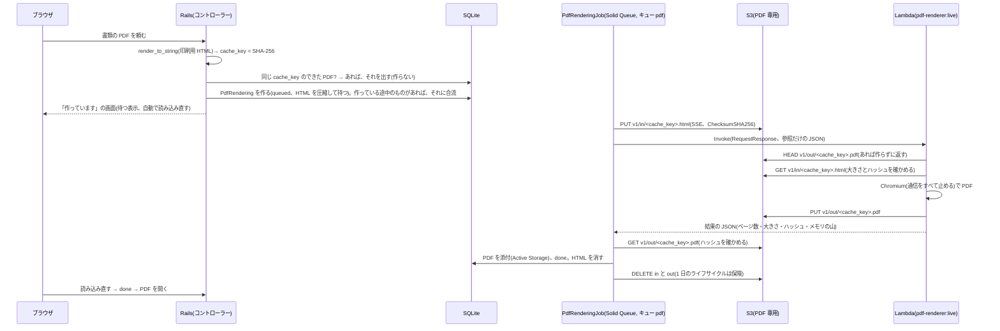

# 基本設計: PDF を AWS Lambda で作る(#22)

- 状態: 提案中(敵対的なレビューの前)。決定の要約は [ADR-0037](../adr/0037-pdf-on-lambda.md)。
- 決まったこと(前提): Issue #22 のコメント「決まったこと: 開発QAボード 第7回」(2026-11-24、理事長)。5 問とも AI のおすすめ。
  - 7-1 `lambda`: Lambda(Chromium と日本語のフォントを入れたコンテナ)で作り、Rails はジョブから頼む。
  - 7-2 `job-then-notify`: ジョブで作る。「作っています」→「開く」。できた PDF は添付として残す。元のデータが変わっていなければ残っている PDF を出す。ジョブの進み具合の画面は EPIC #23。
  - 7-3 `s3-short-lived`: HTML と PDF は PDF 専用の S3(暗号化・非公開)を通し、1 日で消す。ログに中身を書かない。Lambda の通信の上限に合うやりとりの決まり(プロトコル)を作る。
  - 7-4 `new-user`: PDF 専用の IAM ユーザー(ADR-0035)。
  - 7-5 `build-now-switch-safely`: いま作る。12/7 より前に切り替えられなければ 1 月。しばらく Chrome に戻せるスイッチを残す。**Lambda は強くする**(過去に「Chromium のメモリが 100MB を超えると止まる」「通信の失敗のやり直しが適切でない」ことがあった)。
- この文書は設計だけ。コードはまだ書かない。

目次: 1. 全体の形 / 2. プロトコル / 3. 素材(CSS・フォント・画像)と通信の禁止 / 4. 強さ(メモリ・時間切れ・やり直し) / 5. Rails の側 / 6. AWS(CDK) / 7. テスト / 8. 切り替えの段取り・費用 / 9. 危ないこと・決めていないこと / 出どころ

---

## 0. いまの形(読んだコード)

- `app/models/pdf_renderer.rb`(main): `PdfRenderer.render(html)` が Ferrum でヘッドレス Chrome を毎回立ち上げ、`page.content = html` → `page.pdf(format: :A4, print_background: true, prefer_css_page_size: true)` → バイト列を返す。
  - PR #21(`fix/flaky-pdf-9`)で `PdfRenderer.engine`(差し替えられる作り方)、`PdfRenderer::Chrome`(待ち時間 60 秒)、`PdfRenderer::Fake`(テスト用。渡された HTML を覚える)になる。**この設計は #21 のあとを前提にする。**
- 呼ぶのは 6 つのコントローラーの `format.pdf`。どれも `render_to_string` で印刷用の HTML を作り、その場で `send_data`(同期)。

| コントローラー | アクション | テンプレート | ファイル名 |
|---|---|---|---|
| `FilingsController` | `show`(8 書類)・`pack`(一式) | `filings/documents` | `<年度>-<書類>.pdf` / `<年度>-pack.pdf` |
| `StatementsController` | `show`(計算書類の種類) | `statements/show` | `<年度>-<種類>.pdf` |
| `ResolutionsController` | `document`(提案書・同意書・議事録) | `resolutions/document` | `resolution-<id>-<書類>.pdf` |
| `RegistrationFilingsController` | `document`(内訳・互選書・定款) | `registration_filings/document` | `registration-<id>-<書類>.pdf` |
| `LedgersController` | `index`(総勘定元帳)・`show`(1 科目) | `ledgers/index` | `<年度>-ledger.pdf` |
| `FilingSamplesController` | `show`(様式の例。架空の法人) | `filings/documents` | `n-bato-forms-sample.pdf`(attachment) |

- 印刷用のレイアウト `layouts/print.html.erb` は **CSS を `<style>` に直に書き、画像・スクリプト・外のファイルを使わない**。フォントは名前で指定(`"Hiragino Mincho ProN", "Yu Mincho", "Noto Serif CJK JP", "MS Mincho", serif`)。本番のイメージ(Debian)では `fonts-noto-cjk` の Noto Serif CJK JP が使われる。`@pdf` のときはツールバー(リンク)を出さない。
- 本番: Lightsail 2GB、Solid Queue は Puma の中(`SOLID_QUEUE_IN_PUMA`、1 プロセス 3 スレッド、全部のキュー)。Chrome のための swap 2GB。Active Storage はサーバーのディスク(`:local`)。

## 1. 全体の形



### 1.1 呼び方: ジョブから同期(RequestResponse)で呼ぶ

**採用: ジョブが `Invoke(InvocationType: RequestResponse)` で呼び、答えを待つ。** 非同期(Event)+ 結果を待って見に行く(ポーリング)は使わない。

理由:

- **やり直しの持ち主を 1 つにできる。** 非同期の呼び出しは、Lambda が失敗を **既定で 2 回までやり直す**(出どころ [L-retry])。ジョブのやり直しと重なると二重・三重に作る(過去の「やり直しが適切でない」の再来)。同期なら Lambda は自分ではやり直さない(同上)。やり直すのはジョブだけ、と決められる。
- **結果がすぐ分かる。** 非同期だと、結果を S3 に置く・ジョブが一定の間隔で見に行く・いつまで待つかを決める、の 3 つが増える。キューで「何時間も待つ」こともある(同上)。
- **大きさの上限は問題にならない。** 同期の上限は要求・応答とも 6MB、非同期は 1MB(出どころ [L-quota]。以前は 256KB と書かれていたが、いまの文書は 1MB)。どちらにせよ HTML と PDF は S3 を通し、JSON には参照だけを入れる(2 章)ので数 KB。
- 悪い点: ジョブのスレッドが、Lambda が終わるまで(ふだん数秒、最大 90 秒)ふさがる。→ PDF 専用のキュー `pdf` を作り、そのスレッドを 2 つにする(5.5)。ほかのジョブ(Slack・バックアップ・AI)を止めない。
- 悪い点: 待っている間に通信が切れると、Lambda が作り終えたか分からない。→ 出力の場所を cache_key で決めておき(内容で決まる名前)、次の試みは **まず S3 の出力があるかを見る**(4.5)。Lambda の側も、出力があれば作らずに返す。

### 1.2 Lambda の中身(コンテナイメージ)

- ランタイム: Node.js 22(AWS の基本のイメージ `public.ecr.aws/lambda/nodejs:22`、x86_64)。`@sparticuz/chromium`(Lambda 向けに作った Chromium。npm の最新は 153.0.0、2026-09-11)+ `puppeteer-core`。版は 2 つとも固定し、`@sparticuz/chromium` の README の「Puppeteer が対応する Chromium の版に合わせる」に従って組にする(出どころ [SP])。
  - x86_64 にする理由: npm の包みに入っているのは x64 だけ。arm64 は v135 から別の包み(`-min`)で配られ、取り出しの手間が増える(同上)。
  - 代わりの案(とらない): Debian の `chromium` を入れたイメージ + Lambda の Runtime Interface Client。本番の Rails と同じ Chromium になり見比べで差が出にくいが、Lambda で動かすための旗(single-process など)を自分で探して保つことになる。`@sparticuz/chromium` は Lambda で動く旗の組をまとめて持っている。
- **フォントは本番の Rails と同じファイルを入れる。** Dockerfile の段の 1 つを、Rails の本番と同じ Debian(`ruby:4.0.10-slim` の元の版)にして `fonts-noto-cjk` を入れ、その `.ttc` を `/var/task/fonts/` に写す。`@sparticuz/chromium` の fontconfig は `/var/task/fonts` を探す(出どころ [SP]:「Lambda には何のフォントもない」「既定の探す場所は `/var/task/.fonts`・`/var/task/fonts`・`/opt/fonts`・`/tmp/fonts`」)。これで「同じ版の Noto Serif CJK JP」が両方で使われる。
  - 入れるのは Noto Serif CJK と Noto Sans CJK(Regular・Bold)だけ。CSS の `serif` の行き先が Open Sans(包みに入っている英字のフォント)にならないことを、7 章の `pdffonts` の確かめで守る。
- コードの置き場所: `lambda/pdf-renderer/`(`package.json`・`Dockerfile`・`src/handler.ts`・`test/`)。CDK は `infra/lib/pdf-renderer.ts` に部品(Construct)として書き、`NBatoStack` から使う(6 章)。

## 2. プロトコル(Rails ⇔ Lambda)

### 2.1 S3 の置き場所(キー)

```
<PDF 専用のバケット>/
  v1/in/<cache_key>.html    Rails が置く(PUT)。Lambda が読む(GET)
  v1/out/<cache_key>.pdf    Lambda が置く(PUT)。Rails が読んで消す(GET・DELETE)
```

- `v1` はプロトコルの版。互いに合わない変更をするときは `v2/` を足し、しばらく両方を読む。
- 名前は内容で決まる(content-addressed)。同じ中身なら同じキーなので、2 回置いても害がなく、通信が切れたあとに「もうできているか」を名前で調べられる。
- 日付・氏名・書類の名前などはキーに入れない(キーはログや CloudTrail に出る)。`cache_key` は SHA-256 の 16 進 64 文字。

### 2.2 cache_key(同じ PDF を 2 度作らないための鍵)

```
cache_key = SHA-256( "n-bato-pdf" \0 PROTOCOL_VERSION \0 RENDERER_GENERATION \0 canonical_json(options) \0 html_bytes )
```

- `PROTOCOL_VERSION` = 1。`RENDERER_GENERATION` は Rails の定数(整数)。フォントや Chromium を入れ替え、**見た目が変わるので作り直したいとき**に人が 1 つ上げる。Lambda のイメージを入れ替えるたびには上げない(同じ HTML なら同じ見た目、が前提。違えば 7 章の見比べで分かる)。
- `options` は `{ "format": "A4", "print_background": true, "prefer_css_page_size": true }`(いまの Ferrum の呼び方と同じ)。キーを並べ替えた JSON にする。
- エンジン(lambda / chrome)は鍵に入れない。切り替えの間、Chrome で作った PDF も同じ鍵で使い回す(見た目は 7 章で同じと確かめる)。

### 2.3 要求(Invoke の Payload)

```json
{
  "$schema": "https://json-schema.org/draft/2020-12/schema",
  "type": "object", "additionalProperties": false,
  "required": ["protocol", "request_id", "cache_key", "input", "output", "options", "limits", "deadline_at"],
  "properties": {
    "protocol":   { "const": 1 },
    "request_id": { "type": "string", "pattern": "^pdf-[0-9]+-a[0-9]+$", "description": "PdfRendering の id と試みの回数。ログの照合用。中身は入れない" },
    "cache_key":  { "type": "string", "pattern": "^[0-9a-f]{64}$" },
    "input":  { "type": "object", "additionalProperties": false, "required": ["bucket", "key", "sha256", "bytes"],
                "properties": { "bucket": {"type": "string"}, "key": {"type": "string", "pattern": "^v1/in/[0-9a-f]{64}\\.html$"},
                                "sha256": {"type": "string", "pattern": "^[0-9a-f]{64}$"}, "bytes": {"type": "integer", "minimum": 1, "maximum": 10485760} } },
    "output": { "type": "object", "additionalProperties": false, "required": ["bucket", "key"],
                "properties": { "bucket": {"type": "string"}, "key": {"type": "string", "pattern": "^v1/out/[0-9a-f]{64}\\.pdf$"} } },
    "options": { "type": "object", "additionalProperties": false,
                 "properties": { "format": {"const": "A4"}, "print_background": {"type": "boolean"}, "prefer_css_page_size": {"type": "boolean"} } },
    "limits":  { "type": "object", "additionalProperties": false, "required": ["max_pages", "max_output_bytes"],
                 "properties": { "max_pages": {"type": "integer", "maximum": 1000}, "max_output_bytes": {"type": "integer", "maximum": 52428800} } },
    "deadline_at": { "type": "integer", "description": "UNIX ミリ秒。これを過ぎていたら作らずに DEADLINE_EXCEEDED を返す(待たされた古い頼みを捨てる)" }
  }
}
```

- バケットとキーは Lambda の側でも決まった形か確かめる(違うバケット・違う場所を読ませない)。バケットは Lambda の環境変数の 1 つと同じでなければ断る。
- 署名付き URL(presigned URL)は使わない。Lambda は自分の役割(IAM ロール)で S3 を読み書きする。理由: URL そのものが鍵になり、要求の JSON に秘密が入る。ロールなら JSON に秘密がない。

### 2.4 応答

```json
{
  "type": "object", "required": ["protocol", "request_id", "status"],
  "properties": {
    "protocol":   { "const": 1 },
    "request_id": { "type": "string" },
    "status":     { "enum": ["ok", "error"] },
    "reused":     { "type": "boolean", "description": "出力がもうあったので作らなかった" },
    "output":  { "type": "object", "required": ["bucket", "key", "bytes", "sha256", "pages"],
                 "properties": { "bucket": {"type":"string"}, "key": {"type":"string"}, "bytes": {"type":"integer"}, "sha256": {"type":"string"}, "pages": {"type":"integer"} } },
    "error":   { "type": "object", "required": ["code", "retryable"],
                 "properties": { "code": {"enum": ["INVALID_REQUEST", "UNSUPPORTED_PROTOCOL", "DEADLINE_EXCEEDED", "INPUT_NOT_FOUND", "INPUT_CHECKSUM_MISMATCH",
                                                   "INPUT_TOO_LARGE", "TOO_MANY_PAGES", "OUTPUT_TOO_LARGE", "RENDER_TIMEOUT", "BROWSER_LAUNCH_FAILED",
                                                   "BROWSER_CRASHED", "S3_ERROR", "INTERNAL"]},
                                 "retryable": {"type": "boolean", "description": "Lambda の見立て。決めるのは Rails の表(4.4)"},
                                 "detail": {"type": "string", "maxLength": 200, "description": "例外の種類の名前など。HTML・URL・ページの文は入れない"} } },
    "metrics": { "type": "object",
                 "properties": { "cold_start": {"type":"boolean"}, "duration_ms": {"type":"integer"}, "launch_ms": {"type":"integer"}, "render_ms": {"type":"integer"},
                                 "peak_rss_mb": {"type":"integer"}, "memory_limit_mb": {"type":"integer"}, "tmp_free_mb": {"type":"integer"}, "blocked_requests": {"type":"integer"} } },
    "renderer": { "type": "object", "properties": { "build": {"type":"string"}, "chromium": {"type":"string"}, "puppeteer": {"type":"string"} } }
  }
}
```

- 分かっている失敗は、例外を投げずに `status: "error"` で返す(Lambda の `FunctionError` にしない)。例外のまま終わるのは、予想していない失敗と、Lambda のランタイムが止めたとき(時間切れ・メモリ切れ)だけ。この 2 つを Rails は `FunctionError` で見分ける(4.4)。
- 応答は数 KB。6MB の上限には遠い。

### 2.5 暗号化・寿命・権限・ログ

- バケット: 公開をすべて止める・TLS だけ(`enforceSSL`)・SSE-S3 の既定の暗号化・バージョニングなし(消したら本当に消える)・オブジェクトの所有はバケットの持ち主(ACL を使わない)。
- 寿命: ライフサイクルで `v1/` を **1 日で消す**。ただしそれは保険で、ふだんは Rails が添付したすぐあとに in と out を消す(数分で消える)。S3 のライフサイクルの消去は、期限のあと非同期に行われる(期限ちょうどには消えない。出どころ [S3-lc])。
- KMS(お客が管理する鍵)は使わない(バックアップのバケットと同じ SSE-S3)。理由: 中身が数分しか置かれず、鍵の管理・費用(月 1 ドル + 呼び出し)を足すほどの差がない。9 章の決めていないことに残す。
- IAM: 6.3。Rails の PDF 用ユーザーは「in に置く・out を読む・両方を消す・この関数を呼ぶ」だけ。
- **ログに中身を書かない**(7-3)。
  - Lambda: 要求の JSON をそのまま出さない(`console.log(event)` を禁止。lint の決まりとテストで守る)。出すのは 1 行の JSON: `request_id`・`cache_key` の先頭 12 文字・状態・エラーのコード・時間・ページ数・大きさ・メモリ。ページの `console`・`pageerror`・ブロックした要求の URL は出さない(数だけ)。例外の文は `detail` に種類の名前だけ。ログの保存は 30 日。
  - Rails: ジョブの引数は `PdfRendering` だけ(GlobalID。HTML を引数にしない。Solid Queue は引数を DB に残すため)。Lambda の応答をそのままログに出さない。`error_message` は 4.4 の表の文と `detail` だけ。

## 3. 素材(CSS・フォント・画像)と通信の禁止

### 3.1 素材の決まり: 印刷用の HTML は 1 つのファイルで完結させる

- CSS は `<style>` に直に書く(いまの `layouts/print` のまま)。
- 画像を入れるとき(これからの印影・ロゴなど)は `data:` の URI にする。そのための helper(例: `inline_image_tag(blob_or_path)`)を足す。大きい画像は Rails の側で縮めてから入れる(HTML の上限 10MB に入るように)。
- スクリプトは使わない(Lambda でも止める)。外のフォント(Web フォント)は使わない。フォントは名前で指定し、Lambda のイメージに入れたものを使う(1.2)。
- **守り方**: Rails の側の `PdfRenderer::HtmlCheck` が、送る前に HTML を Nokogiri で見て、`src`・`href`(`<link>`)・CSS の `url(...)`・`@import` のうち `data:` でないものを数える。テストと開発では例外にする(気づかないまま本番に出さない)。本番では警告を 1 行(数だけ)出して続ける(Lambda の側で止まるので、出る PDF から抜けるだけ)。6 つの書類のテストで「外を参照していない」を確かめる。

### 3.2 Lambda の中の通信の禁止(三重)

1. **ページの要求を止める**: Puppeteer の `page.setRequestInterception(true)` で、`data:` と `about:blank` 以外をすべて `abort()`。止めた数を `blocked_requests` に数える(URL はログに出さない)。加えて `page.setOfflineMode(true)` と `page.setJavaScriptEnabled(false)`。
2. **Chromium の旗**: `--proxy-server=127.0.0.1:9`(つながらない先)と `--host-resolver-rules=MAP * ~NOTFOUND`(名前を引けない)。`@sparticuz/chromium` の既定の旗のうち `--disable-web-security` と `--allow-running-insecure-content` は外す(要らない。外のファイルを読ませる穴になる)。旗が効くかは 7.4 の攻撃のテストで確かめる(未確認)。
3. **Lambda を外に出られない網に置く**(おすすめ、9 章で確かめる): Lambda を VPC の「外へ出られないサブネット」(NAT なし)に置き、S3 だけはゲートウェイ型の VPC エンドポイントで通す。1 と 2 が破られても、インターネット・メタデータのアドレスに届かない。NAT とゲートウェイ型のエンドポイントは費用 0(NAT を置かないため)。CloudWatch Logs へのログは Lambda の仕組みが送るので、エンドポイントは要らない(未確認。P1 で確かめる)。

## 4. 強さ(この設計の柱)

### 4.1 過去の 2 つの不具合を、どう防ぐか

| 過去の不具合 | ありそうな原因(推測) | この設計での防ぎ方 |
|---|---|---|
| Chromium のメモリが 100MB を超えると止まる | 関数のメモリが小さすぎた(既定は 128MB)/ `/dev/shm` が無い・小さい Lambda で Chromium の共有メモリが足りなかった / 複数のプロセスで動かした | メモリは 2048MB から(`@sparticuz/chromium` の README は「最低 512MB、1600MB 以上をすすめる」[SP])。`--single-process`(同じ包みの既定)と `--disable-dev-shm-usage`(共有メモリの代わりに /tmp を使う。効くかは P1 で確かめる)。**メモリの山を毎回測って記録し**(4.2)、ストレスのテストを半分のメモリ(1024MB)で通すことを切り替えの条件にする |
| 通信に失敗したときのやり直しが適切でない | AWS の SDK の既定: Ruby の SDK は待ち時間 60 秒で読み取りを打ち切り(`http_read_timeout` の既定 60)、通信の失敗として **3 回までやり直す**(`retry_mode: legacy`、`retry_limit` の既定 3)。Lambda が 60 秒を超えると、SDK が同じ要求をまた送り、裏で Chromium が 2〜4 つ同時に動く(このリポジトリの aws-sdk-core 3.272.0 のソースで確かめた) | Lambda の呼び出しは **SDK のやり直しを切る**(`max_attempts: 1`)、**読み取りの待ち時間を Lambda の時間切れより長く**する(100 秒 > 90 秒)。やり直すのはジョブだけ(4.4)。同じ cache_key は同時に 1 つしか動かさない(4.5) |

### 4.2 メモリ

- 初めの値: **2048MB**(1,769MB で vCPU 1 つ分 [L-quota]。Chromium の立ち上がりと組版は CPU を使うので、少し上にする)。`/tmp` は 1024MB。
- 測り方(毎回):
  - Lambda の `REPORT` の行の `Max Memory Used`(実行の環境まるごと。子のプロセスも入る)。CloudWatch Logs Insights でまとめて見る。
  - 関数の中で 100 ミリ秒ごとに、Chromium のプロセス(`browser.process().pid` と、その子)の `/proc/<pid>/status` の `VmRSS` と、Node の `process.memoryUsage().rss` を足し、その最大を `peak_rss_mb` として応答とログに入れる。Rails は `PdfRendering#peak_memory_mb` に残す(書類の種類ごとの傾向が分かる)。
  - CloudWatch の Embedded Metric Format でメトリクス `PeakRssMb`・`DurationMs`・`Pages` を出し、**`PeakRssMb` が関数のメモリの 60% を超えたら警報**(SNS でメール。宛先は運用の側で決める)。
- 決め方: P1 で 1024 / 1536 / 2048MB でストレスのテスト(7.3)を流し、いちばん重いものの山の **2 倍以上**を関数のメモリにする。新しい AWS のアカウントはメモリの上限が下げられていることがある [L-quota](9 章)。
- メモリ切れの次の試み: ランタイムが止めた(`FunctionError` で、メモリ切れ・時間切れ・異常終了)ときの 2 回目は、**同じイメージでメモリを倍にした関数 `pdf-renderer-large`(4096MB)** に回す。それでも駄目なら「作れない入力」として止める(4.6)。

### 4.3 時間切れ(外側ほど長く)

| 層 | 値 | 何が起きるか |
|---|---|---|
| Chromium: `setContent` | 15 秒(外を読まないので、ふだん 1 秒もかからない) | `RENDER_TIMEOUT` |
| Chromium: `page.pdf` | Lambda の残り時間 − 10 秒(`context.getRemainingTimeInMillis()`)。上限 70 秒 | `RENDER_TIMEOUT`。片づけ(ブラウザを閉じる・/tmp を消す)と S3 への PUT の 10 秒を残す |
| Lambda 関数 | **90 秒**(上限は 1,800 秒 [L-quota]) | ランタイムが止める → `FunctionError` |
| Ruby の Lambda の呼び出し | 接続 5 秒、読み取り **100 秒**、SDK のやり直し 0 | 接続できない → やり直してよい。読み取りの時間切れ → 結果が分からない(4.5) |
| Ruby の S3 | 接続 5 秒、読み取り 30 秒、SDK のやり直し 3(standard)。PUT・GET・DELETE は何度やっても同じ結果なので SDK に任せてよい | |
| 1 つの PdfRendering の全体 | 頼まれてから **10 分**(`deadline_at`)。過ぎたらやり直さず failed | 待たされた古い頼みを作らない |
| 待つ画面 | 3 分を超えたら「時間がかかっています」を出す(文は見直し票で決める) | |

- ブラウザは **呼び出しごとに立ち上げて閉じる**(温まった環境でも使い回さない)。1 回 0.5〜1 秒ほど余計にかかるが、前の呼び出しのメモリ・壊れた状態を持ち越さない。`--user-data-dir` は呼び出しごとに `/tmp/chrome-<uuid>` を作り、`finally` で消す(Playwright で /tmp が溜まって `ERR_INSUFFICIENT_RESOURCES` になる例が README にある [SP])。閉じる前にページを閉じ、`browser.close()` を待つ(同上)。閉じられなければ 5 秒で `SIGKILL`。
- 呼び出しの初めに `/tmp` の空きを測り、200MB を切っていたら古い `/tmp/chrome-*` を消してから進む。

### 4.4 やり直しの決まり(やり直すのはジョブだけ)

- **Lambda はやり直さない。** 中で S3 の SDK が自分でやり直すのだけ許す(何度やっても同じ結果になる操作)。Chromium の立ち上げ・組版はやり直さない。非同期の呼び出しを使わないので、Lambda の仕組みのやり直しもない。
- **Ruby の SDK は Lambda の呼び出しをやり直さない**(`max_attempts: 1`)。
- **ジョブ**(`PdfRenderingJob`)が、次の表でやり直す。待ち時間は指数 + ゆらぎ(jitter ±25%)。ActiveJob の `retry_on ... wait: ->(n) { ... }` で書き、試みの回数は `PdfRendering#attempts` にも残す。

| 分類 | 何が起きたか(例) | やり直す | 回数(全部で) | 待ち | 尽きたら |
|---|---|---|---|---|---|
| 一時的 | `TooManyRequestsException`(429、同時に動く数の上限)・`ServiceException`(5xx)・`ResourceNotReadyException`(デプロイの直後)・接続できない・S3 の 5xx・`S3_ERROR`・`BROWSER_LAUNCH_FAILED` | する | 5 | 5 秒・20 秒・60 秒・120 秒(429 は 2 倍) | failed(`transient_exhausted`)。切り替えの間は Chrome に回す(4.7) |
| 結果が分からない | Ruby の読み取りの時間切れ・接続が途中で切れた | する。**先に S3 の出力を見る**(4.5) | 一時的と同じ枠 | 同上 | 同上 |
| 重い入力かもしれない | `FunctionError`(時間切れ・メモリ切れ・異常終了)・`BROWSER_CRASHED`・`RENDER_TIMEOUT` | 1 回だけ、`pdf-renderer-large` で | 2 | 10 秒 | failed(`render_failed`)。Chrome には回さない(本番のサーバーで同じことが起きるのを避ける) |
| 入力が悪い(やり直しても同じ) | `TOO_MANY_PAGES`・`INPUT_TOO_LARGE`・`OUTPUT_TOO_LARGE`・`INVALID_REQUEST`・`UNSUPPORTED_PROTOCOL` | しない | 1 | — | failed。理由をそのまま画面に |
| 途中で壊れた | `INPUT_NOT_FOUND`・`INPUT_CHECKSUM_MISMATCH` | HTML を置き直して 1 回 | 2 | 0 | failed(`internal`) |
| 設定の誤り | `AccessDeniedException`・`ResourceNotFoundException`・鍵が無い(`MissingCredentialsError`)・`DEADLINE_EXCEEDED` | しない | 1 | — | failed。切り替えの間は Chrome に回す(4.7)。設定の誤りは 1 回で警報(ログの `error` + Slack の運用の知らせは #23 で) |
| 予想していない | 上のどれでもない例外 | しない | 1 | — | failed(`internal`)。例外の種類の名前だけを残す |

- **作れない入力(poison)**: 「重い入力かもしれない」が 2 回続いた cache_key は、`PdfRendering` が `render_failed` で残る。同じ cache_key をまた頼まれたら、**1 時間はすぐに失敗を見せ**(作り直さない)、画面の「もう一度作る」(人が明示)でだけ作り直す。同じ書類の中身が変われば cache_key が変わるので、ふつうに作られる。
- やり直しで同じ Lambda を何度も起こさないよう、全体の期限(10 分)を過ぎたらやめる。

### 4.5 二重に作らない(5 重)

1. **できた PDF を使い回す**: 同じ cache_key の `done` の `PdfRendering` に PDF が付いていれば、それを出す(Lambda を呼ばない)。
2. **作っている途中に合流する**: 同じ cache_key で `queued`・`rendering` のものがあれば、新しく作らずにそれを返す。SQLite の部分の一意の索引(`UNIQUE (cache_key) WHERE status IN ('queued','rendering')`)で、同時に 2 つできないことを DB が守る。ぶつかったら作り直さず、ある方を読み直して返す。
3. **ジョブを同時に 1 つ**: Solid Queue の `limits_concurrency to: 1, key: ->(r) { r.cache_key }, duration: 5.minutes`。
4. **Lambda の側で出力を見る**: 作る前に `HEAD v1/out/<cache_key>.pdf`。あって `x-amz-meta-input-sha256` が要求と同じなら作らずに `reused: true` で返す。
5. **SDK が呼び出しをやり直さない**(4.4)。

- 結果が分からないときの次の試み: ジョブは Lambda を呼ぶ前に `HEAD v1/out/<cache_key>.pdf` を見る。あれば読んで、ハッシュを確かめて終わる。Lambda の読み取りの待ち時間(100 秒)は関数の時間切れ(90 秒)より長いので、「Rails があきらめたあとも Lambda が動いていて、あとから出力が置かれる」ことは、通信が切れたときだけ。そのときは次の試みと並ぶが、出力は同じ中身の同じキーなので害はない(費用が 1 回分増えるだけ)。
- S3 は書いたすぐあとに読んでも新しい中身が返る(strong read-after-write consistency、2020 年 12 月から。出どころ [S3-cons]、本文は未確認)。HEAD にも ListBucket の権限を付ける(無いと、無いものを HEAD したとき 404 でなく 403 が返り、「無い」と「権限が無い」が見分けられない)。

### 4.6 ページ数・大きさの上限

| 上限 | 値(初め) | どこで | 理由 |
|---|---|---|---|
| HTML の大きさ | 10MB | Rails(送る前)・Lambda(GET の前に `bytes` と HEAD の大きさ) | 6 つの書類はいま数十 KB〜数百 KB。画像を `data:` で入れても 10MB に収める |
| ページ数 | 300 | Lambda。`page.pdf({ pageRanges: "1-301" })` で 301 ページ目までだけ作り、301 ページあれば `TOO_MANY_PAGES` | 総勘定元帳 1 年分でも数十ページの見込み。上限を超える組版にメモリを使わない(組版はするので、効くのは PDF を書き出す分だけ。7.3 で確かめる) |
| PDF の大きさ | 50MB | Lambda(PUT の前) | 添付とバックアップを重くしない |
| 同時に作る数 | Rails 2(キュー `pdf` のスレッド) | Rails | 9 章: アカウントの同時実行の上限 |

- ページ数の数え方: Chromium の出す PDF のページの木(`/Type /Pages` の `/Count`)を読む。`pdf-lib` で読むとメモリを食うので、まず PDF の後ろの方から `/Count` を探す小さい読み取りを書き、P1 で 6 つの書類とストレスのもので `pdfinfo` の数と合うか確かめる(未確認)。

### 4.7 Chrome に戻すスイッチ(切り替えの間)

- 環境変数(`config/deploy.yml` の `env.clear`):
  - `NBATO_PDF_ENGINE` = `lambda` | `chrome`(本番の初めは `chrome`。テストは `fake`)。
  - `NBATO_PDF_FALLBACK` = `chrome` | `none`(切り替えの間は `chrome`)。
- 戻し方は 2 つ。
  - **手で**: `NBATO_PDF_ENGINE=chrome` にして `bin/kamal deploy`(数分)。Lambda の不具合が続くとき。
  - **自動で(1 件ずつ)**: 「一時的」が尽きたとき・「設定の誤り」のときだけ、その 1 件を本番のサーバーの Chrome で作る。`PdfRendering#engine` に `chrome`、`fallback_reason` に理由を残す。**「重い入力」では戻さない**(Lambda で 4GB でも作れないものを、2GB のサーバーで作らせない)。
- Chrome で作るとき(自動・手)は、サーバーのメモリを守るため **同時に 1 つ**(`limits_concurrency to: 1, key: "chrome"`)。
- ジョブで作る流れ(5 章)は、エンジンが `chrome` のままでも動く。**まず流れだけを Chrome のまま出し、そのあとエンジンを切り替える**(8 章)。2 つの変更を別の日にできる。
- Rails のイメージから Chromium を外すのは、Lambda で数週間 Chrome に戻らなかったことを確かめてから(別の Issue。外したら、このスイッチはなくなる)。

### 4.8 立ち上がり(cold start)・同時に動く数・失敗したときの見え方

- 立ち上がり: コンテナのイメージは大きい(Chromium・Node・CJK のフォントで数百 MB)ので、デプロイの直後とひさしぶりの呼び出しは数秒〜十数秒かかる見込み(未確認。P1 で測り、`cold_start` と時間を記録する)。ジョブで待つので画面は固まらない。常に温めておく(Provisioned Concurrency)は費用がかかるのでしない。
- 同時に動く数: Rails の側で 2 に絞る。Lambda の予約の同時実行(reserved concurrency)は付けたいが、**新しいアカウントは同時実行の上限が下げられていて**(既定 1,000 [L-quota] が、新しいアカウントでは小さい)、予約はアカウントの上限から 100 を残した分までしか付けられない(未確認)。cdk deploy の前に `aws lambda get-account-settings` で上限を見て決める(9 章)。
- 失敗したときの見え方(文と並びは見直し票): 待つ画面が「作れませんでした」に変わり、理由を平らな言葉で出す(「ページが多すぎます(上限 300 ページ)」「いま混んでいます。もう一度作るを押してください」など)。**いつでも HTML の画面からブラウザの印刷で PDF にできる**ことを案内する(最後の逃げ道。7-1 の `browser-print` の案を逃げ道として残す)。

## 5. Rails の側

### 5.1 エンジン(`PdfRenderer`)

#21 の形をそのまま広げる。

```ruby
class PdfRenderer
  PROTOCOL_VERSION = 1
  RENDERER_GENERATION = 1
  OPTIONS = { format: "A4", print_background: true, prefer_css_page_size: true }.freeze

  # エンジンを選ぶ: NBATO_PDF_ENGINE(lambda / chrome)。テストは Fake。
  def self.engine = @engine || ENGINES.fetch(ENV.fetch("NBATO_PDF_ENGINE", "chrome"))
  def self.render(html) = engine.render(html)   # いまの呼び方(バイト列を返す)。残す
  def self.build(html, rendering:) = engine.build(html, rendering:) # ジョブが使う。Output を返す
  def self.cache_key(html) = ... # 2.2

  Output = Data.define(:bytes, :pages, :engine, :metrics, :renderer)

  module Chrome   # いまの Ferrum。build は render を包むだけ(pages は数える)
  module Fake     # いまの偽物。build も覚える。失敗を仕込める(Fake.fail_next!(:transient) など)
  class Lambda    # 新しい。下の手順
  class Error < StandardError; attr_reader :code, :category; end  # category: transient / unknown / heavy / input / broken / config / internal
end
```

`PdfRenderer::Lambda#build(html, rendering:)` の手順:

1. `HtmlCheck`(3.1)。大きさが 10MB を超えたら `Error(input)`。
2. `HEAD out` → あれば 6 へ。
3. `PUT in`(`checksum_algorithm: "SHA256"`、`content_type: text/html; charset=utf-8`)。
4. `Invoke`(関数は `NBATO_PDF_FUNCTION`。重い入力の 2 回目は `NBATO_PDF_FUNCTION_LARGE`)。応答を 2.4 の形で確かめる(形が違えば `internal`)。
5. エラーを 4.4 の表で `Error` にして投げる。
6. `GET out`、SHA-256 が応答と同じか確かめる。`Output` を返す。
- S3 の後片づけ(`DELETE in`・`DELETE out`)はジョブが添付したあと。消すのに失敗してもジョブは失敗にしない(1 日で消える)。
- クライアント: `Aws::Lambda::Client.new(region: "ap-northeast-1", retry_mode: "standard", max_attempts: 1, http_open_timeout: 5, http_read_timeout: 100, credentials: …)`、`Aws::S3::Client.new(…, retry_mode: "standard", max_attempts: 3, http_read_timeout: 30)`。テストでは `stub_responses: true` のクライアントを渡す(`Backup::Upload` と同じく注入できるようにする)。
- Gemfile に `aws-sdk-lambda`(`require: false`)を足す。
- 環境変数: `NBATO_PDF_BUCKET`・`NBATO_PDF_FUNCTION`(`arn:…:function:n-bato-pdf-renderer:live`)・`NBATO_PDF_FUNCTION_LARGE`・`NBATO_PDF_AWS_ACCESS_KEY_ID`・`NBATO_PDF_AWS_SECRET_ACCESS_KEY`(秘密、`.kamal/secrets` は `NBATO_SECRETS_DIR` から読む書き方だけ)。

### 5.2 PDF を作る記録 `PdfRendering`(長いイベント)

`FilingDestinationSearch` と同じ形の「長いイベント(LE)」。頼まれた日時は `requested_at`、いまの状態は `status`。`docs/data-model.md` に足す。操作履歴には残さない(`self.audited = false`。元に戻す対象ではない)。

| 列 | 型 | 意味 |
|---|---|---|
| `requested_at` | datetime, null: false | 頼まれた日時(出来事の日時) |
| `requested_by_id` | integer(User) | 頼んだ人(#23 の「自分のジョブ」) |
| `title` | string | 画面に出す書類の名前(例「事業報告書等一式 2024 年度」)。氏名は入れない |
| `source_path` | string | 頼んだ画面の HTML の path(例 `/annual_reports/2024/pack`)。#23 の「元の画面へ」と「もう一度作る」に使う |
| `filename`・`disposition` | string | いまの `send_data` と同じ値 |
| `cache_key` | string(64), index | 2.2 |
| `html_bytes` | integer | |
| `source_html` | binary(gzip) | 送る HTML。**done になったら消す**(DB とバックアップに中身を残しすぎない)。failed のものは 1 日で消す(毎時の掃除のジョブ) |
| `status` | string | `queued` → `rendering` → `done` / `failed` |
| `attempts` | integer | 試みた回数 |
| `failure_code` | string | 4.4 の分類とコード(`input:TOO_MANY_PAGES` など) |
| `error_message` | text | 表の文 + `detail`。中身は入れない |
| `engine` | string | 作ったエンジン(`lambda` / `chrome` / `fake`) |
| `fallback_reason` | string | Chrome に回した理由 |
| `started_at`・`finished_at` | datetime | |
| `page_count`・`byte_size`・`duration_ms`・`peak_memory_mb` | integer | 4.2 |
| `cold_start` | boolean | |
| `renderer_build` | string | Lambda のイメージの版・Chromium の版 |
| `has_one_attached :pdf` | | できた PDF |

- 作る入口: `PdfRendering.request!(html:, title:, source_path:, filename:, disposition:, by:)` → 使い回す・合流する・新しく作ってジョブを積む、のどれかをして記録を返す(4.5 の 1・2)。もう一度作る: `PdfRendering.request!(…, force: true)`(作れない入力の 1 時間の止めを外す)。
- 状態を変えるのはジョブだけ(`start!`・`finish!(output)`・`fail!(error)`)。
- 残すもの: 書類(`source_path`)ごとに一番新しい `done` は残す。それより古い `done` の PDF は 30 日で消す(9 章の決めていないこと)。
- **EPIC #23(ジョブの進み具合)との関係**: ここでは画面を作らない。#23 が要るものを持たせておく。
  - 動いている数: `status IN (queued, rendering)`。
  - 確認待ちの数(できたが、頼んだ人がまだ開いていない): #23 で「開いた」という出来事(例 `PdfRendering::Opening`、E、`opened_at`)を足す。ここでは `requested_by`・`finished_at` を持つところまで。
  - ほかのジョブ(AI の調べもの・仕訳の提案)と並べて出すために、`status`・`status_label`・`title`・`requested_by`・`requested_at`・`finished_at`・`result_path` の 7 つを、どの記録も同じ名前で答える約束(concern の名前は #23 で決める)にする。

### 5.3 ジョブ `PdfRenderingJob`

```ruby
class PdfRenderingJob < ApplicationJob
  queue_as :pdf
  limits_concurrency to: 1, key: ->(rendering) { rendering.cache_key }, duration: 5.minutes
  # retry_on は分類ごと(4.4)。discard_on は input / config / internal
  def perform(rendering) # 引数は記録だけ
    return if rendering.done? || rendering.past_deadline?
    rendering.start!
    output = PdfRenderer.build(rendering.html, rendering:)
    rendering.finish!(output)   # 添付・done・HTML を消す(1 つのトランザクション。添付のファイルは先に書く)
    PdfRenderer.cleanup(rendering) # S3 の in・out を消す(失敗しても無視)
  end
end
```

- 添付してから done にする(done なのに PDF が無い、を作らない)。添付のファイルを書いたあと DB の更新で失敗したら、次の試みは S3 の出力を見つけて作らずに済む(4.5)。

### 5.4 6 つのコントローラーの変わり方

いまの `send_data PdfRenderer.render(html), …` を、共通の concern `PdfResponse` の 1 行にする。

```ruby
format.pdf do
  @pdf = true
  respond_with_pdf render_to_string(:documents, formats: [ :html ]), title: @title, filename: "...", disposition: "inline"
end
```

`respond_with_pdf` は `PdfRendering.request!` を呼び、

- `done`(使い回し)→ すぐに PDF を出す(下の「渡し方」)。**元のデータが変わっていなければ、いまと同じく押してすぐ開く**。
- それ以外 → 待つ画面(`PdfRenderingsController#show`)へ送る。

渡し方: PDF は **ログインした人だけ** に、`PdfRenderingsController#show`(`format.pdf`)から `send_data rendering.pdf.download` で出す。Active Storage の公開の URL(`rails_blob_path`・`url_for(attachment)`)は使わない(署名だけで、ログインなしに開ける。中身は役員の氏名・住所・金額)。

HTML を作るのは、いまと同じくリクエストの中(数十ミリ秒)。ジョブの中で作り直さない(コントローラーごとに用意する変数が違い、ジョブで再現するのは難しく、ずれの元になる)。cache_key は HTML から決まるので、「元のデータが変わったか」は HTML が変わったかで正しく分かる。HTML に毎回変わるもの(時刻・CSRF のトークン・CSP の nonce)が入らないことを、6 つの書類のテストで確かめる(同じデータで 2 回作って cache_key が同じ)。

**見直し票で決めること(画面は作る前に案を出す。CLAUDE.md・ADR-0012)**:

1. PDF のリンク(いま `new_tab_link_to "PDF"`、別のタブ)を押したあと、別のタブに待つ画面を出すか、元の画面の中(リンクの所)に「作っています」→「開く」を出すか。
2. 待つ画面の文・待つ表示(`nb-waiting` + `auto-reload`、「あと何秒で読み込み直すか」)の使い方、3 分を超えたときの文。
3. 失敗したときの文、「もう一度作る」と「HTML を開いてブラウザで印刷する」の出し方。
4. できたあと自動で PDF を開くか、「開く」を押してもらうか(ブラウザのポップアップの止めに当たらないか)。
5. 事業報告書等一式のように重いものの「作っています」の間に、ほかの書類を頼めるか(並べて待つ)。
6. GET の PDF のリンクで記録を作ってよいか、POST のボタン(`button_to`)にするか(ADR-0008「出来事は create」との関係。おすすめは POST `/pdf_renderings` にし、コントローラーは `PdfRenderingsController#create`・`#show` の 2 つ。ただしボタンの見た目が変わる)。
7. 様式の例(`FilingSamplesController`)の「ダウンロード」(attachment)も同じ流れにするか。中身が固定なので、1 回作れば以後は使い回しで、すぐに出る。

### 5.5 キュー

- `config/queue.yml` に `pdf` だけを受け持つワーカーを足す(スレッド 2)。いまのワーカー(`*`)は `pdf` を除く。Puma の中のまま。
- Chrome で作るとき(4.7)は 1 つずつ。

## 6. AWS(CDK)

`infra/lib/pdf-renderer.ts` に `PdfRenderer` の Construct を作り、`NBatoStack` から使う。cdk deploy・鍵の受け渡しは人に確かめる(ADR-0035。IAM ユーザーを足すこと自体は聞かない)。

### 6.1 Lambda

- `lambda.DockerImageFunction`、`DockerImageCode.fromImageAsset('../lambda/pdf-renderer', { platform: Platform.LINUX_AMD64 })`。cdk deploy がイメージを作って、CDK の bootstrap の ECR に置く(専用の ECR を作って自分で push するより、手順が 1 つで済む)。古いイメージは `cdk gc` で消す(9 章)。
- `architecture: X86_64`・`memorySize: 2048`・`ephemeralStorageSize: 1024 MiB`・`timeout: 90s`・`retryAttempts: 0`(非同期で呼ばれても Lambda がやり直さない。保険)・`maxEventAge` 最短・環境変数 `PDF_BUCKET`・`NODE_OPTIONS=--enable-source-maps`。
- 同じイメージで `pdf-renderer-large`(`memorySize: 4096`)。
- 版とエイリアス: `currentVersion` に `live` のエイリアス。Rails は `:live` を呼ぶ。戻すときはエイリアスを前の版に向ける。
- ログ: `logGroup` を作り、保存は 30 日。
- 網: 3.2 の 3(VPC・外へ出られないサブネット・S3 のゲートウェイのエンドポイント)。`ec2.Vpc({ natGateways: 0, subnetConfiguration: [{ subnetType: PRIVATE_ISOLATED }] })`。
- 警報: `PeakRssMb > 60%`・エラーの数・`Throttles` が 0 より大きい。

### 6.2 S3

`s3.Bucket('PdfBucket', { blockPublicAccess: BLOCK_ALL, encryption: S3_MANAGED, enforceSSL: true, versioned: false, objectOwnership: BUCKET_OWNER_ENFORCED, lifecycleRules: [{ prefix: 'v1/', expiration: Duration.days(1) }], removalPolicy: DESTROY, autoDeleteObjects: false })`。

- 中身は一時的なので、スタックを消すときは消してよい(バックアップのバケットは RETAIN のまま)。

### 6.3 権限

PDF 用の IAM ユーザー `PdfUser`(Rails):

| 動作 | 対象 |
|---|---|
| `s3:PutObject` | `PdfBucket/v1/in/*` |
| `s3:GetObject`・`s3:DeleteObject` | `PdfBucket/v1/out/*` |
| `s3:DeleteObject` | `PdfBucket/v1/in/*` |
| `s3:ListBucket` | `PdfBucket`(条件 `s3:prefix` = `v1/out/*`。HEAD で 404 を受けるため) |
| `lambda:InvokeFunction` | 2 つの関数の `live` エイリアスの ARN だけ |

Lambda の役割(ロール):

| 動作 | 対象 |
|---|---|
| `s3:GetObject` | `PdfBucket/v1/in/*` |
| `s3:PutObject`・`s3:GetObject` | `PdfBucket/v1/out/*` |
| `s3:ListBucket` | `PdfBucket`(条件 `v1/out/*`) |
| ログ・VPC | `AWSLambdaBasicExecutionRole`・`AWSLambdaVPCAccessExecutionRole` |

- アクセスキーはスタックに入れない(`AWS::IAM::AccessKey` が 0 のまま)。`bin/infra-credentials keys` に PDF のユーザーを足す。
- Output: `PdfBucketName`・`PdfFunctionAlias`・`PdfFunctionLargeAlias`・`PdfUserName`。

## 7. テスト

### 7.1 Lambda の中(`lambda/pdf-renderer/test/`、jest、CI で毎回)

S3 は `aws-sdk-client-mock`、ブラウザは偽物の launcher を差し込んで:

- 要求の形が違う(版・キーの形・バケット・大きさ)→ `INVALID_REQUEST` / `UNSUPPORTED_PROTOCOL`。
- 期限切れ → 作らずに `DEADLINE_EXCEEDED`。
- 出力がある → 作らずに `reused: true`。メタデータのハッシュが違えば作り直す。
- 入力が無い・ハッシュが違う・大きすぎる。
- ページが多すぎる・PDF が大きすぎる。
- 時間切れ(`getRemainingTimeInMillis` を小さくした偽物)→ `RENDER_TIMEOUT`、ブラウザを閉じ、`/tmp/chrome-*` が残らない。
- ブラウザが落ちた → `BROWSER_CRASHED`。
- **ログに中身が出ない**: HTML に目印の文字列(`CANARY-…`)を入れ、どの経路でもログ(console の全部)に出ないこと。エラーの `detail` にも出ないこと。
- 予想していない例外は投げる(`FunctionError` になる)。

### 7.2 コンテナでの結合(手元・CI の手動の実行)

- 本物のイメージを `docker run --network none` で、AWS の基本のイメージに入っている Runtime Interface Emulator を使って呼ぶ。S3 は MinIO(別の網で Lambda のコンテナとだけつなぐ。関数は `S3_ENDPOINT` を環境変数で受ける、テストのときだけ)。
- `docker run --memory=1024m` で、本番の半分のメモリにして流す(4.2 の条件)。

### 7.3 見比べ(ゴールデン)とストレス

架空のデータ(PR #19 の `bin/demo`・`db/demo/seed.rb`)で、次を **いまの本番のイメージの Chrome(`docker compose`)** と **Lambda のイメージ** の両方で作って比べる。スクリプト `bin/pdf-golden`。

- 6 つの書類のすべての種類: 事業報告書等の 8 書類と一式・計算書類の各種類・決議の 3 書類・登記の 3 書類・総勘定元帳と 1 科目・様式の例。
- ストレス(作った HTML):
  - 300 ページの元帳(約 15,000 行の表)→ 作れる。301 ページ → `TOO_MANY_PAGES`。
  - 1 つのセルにとても長い文・改ページをまたぐ長い表・ページをまたぐ行。
  - `data:` の画像 20 枚(合わせて約 9MB の HTML)→ 作れる。11MB → `INPUT_TOO_LARGE`。
  - 外字・旧字・記号(①〜⑳、全角数字、はしご高・たつさき などの異体字)。豆腐(□)にならないこと。
- 比べ方(どれも満たすこと):
  - ページ数が同じ(`pdfinfo`)。
  - 文字が同じ(`pdftotext -layout` の空白をならしたもの)。
  - フォント(`pdffonts`)が Noto Serif CJK JP / Noto Sans CJK JP だけで、ほかのフォント(Open Sans・DejaVu など)に落ちていない。すべて埋め込み。
  - 見た目: `pdftoppm -r 100` で画像にし、ページごとに ImageMagick の `compare -metric AE -fuzz 10%` で違う画素が **0.5% 以下**(Chromium の版の違いで少しずれる分を見込む。閾値は P1 の結果で決め直す)。違ったページは差の画像を残して人が見る。
  - メモリの山・時間を表にする(書類ごと)。
- 実データでは比べない(このセッションは団体の情報を持たない)。本番での確かめは、架空の法人の「様式の例」で行う(8 章)。

### 7.4 攻撃(通信の禁止の確かめ)

HTML に次を入れ、**どれも外に出ず**(MinIO の外への接続が無い・`blocked_requests` が数える)、PDF は作れること:
``、`<iframe src="https://example.com/">`、`<link rel=stylesheet href=…>`、CSS の `@import`・`url(http…)`・`@font-face`、`file:///etc/passwd`、`<meta http-equiv="refresh">`、`<script>`(動かない)、`fetch` を呼ぶ `onerror`。

### 7.5 負荷

- 同時に 10(Rails の上限の 5 倍)を呼び、アカウントの上限に当たったときに 429 が出て、ジョブが待ってやり直し、全部できること。
- 同じ温まった環境に 50 回続けて呼び、`/tmp` の空きとメモリの山が増えていかないこと(漏れの確かめ)。
- p50・p95 の時間と、立ち上がり(cold start)の回数・時間を記録する。

### 7.6 Rails(`bin/rails test`、Fake)

- `PdfRendering.request!`: 使い回す・合流する(同時に 2 回でも 1 件、1 ジョブ)・新しく作る・作れない入力の 1 時間の止め・`force`。
- ジョブ: 4.4 の表の行ごとに、`PdfRenderer::Fake` に失敗を仕込み、やり直す / やめる / Chrome に回す / 回さない、回数・待ちが表どおり。全体の期限。
- `PdfRenderer::Lambda`: `stub_responses` の Lambda・S3 のクライアントで、手順(HEAD → PUT → Invoke → GET)、応答の形の確かめ、`FunctionError` の分類、ハッシュの違い、読み取りの時間切れのあと S3 の出力で済ませる。
- SDK の設定: Lambda のクライアントの `max_attempts` が 1、読み取りの待ち時間が関数の時間切れより長いこと(設定の値どうしを比べるテスト)。
- 6 つのコントローラー: `format.pdf` で `PdfRendering` ができ、2 回目は使い回し、ログインなしでは PDF を出さない、HTML に外の参照が無い、同じデータで cache_key が同じ。
- ジョブの引数とログに HTML が入らない(目印の文字列で確かめる)。

### 7.7 CDK(`infra/test`、jest)

バケット(公開なし・SSE・TLS・1 日)、IAM ユーザーの権限がこの表の対象だけ(`*` の対象なし)、関数のメモリ・時間切れ・/tmp・アーキテクチャ・`retryAttempts: 0`・エイリアス、VPC に NAT が無い、ログの保存 30 日、アクセスキーが 0。

## 8. 切り替えの段取り・費用

12/7〜12 月中は書面決議と登記の時期(7-5)。**この間にエンジンを切り替えない。** 切り替えたあとで不具合が出たら、すぐ Chrome に戻す(4.7)。

| 段 | すること | 出すもの | 人に確かめること |
|---|---|---|---|
| P0 | この設計を別の Agent に敵対的にレビューさせ、直す | この文書・ADR-0037 | 設計の要点(開発QAボード) |
| P1 | Lambda の中身とテスト。手元のコンテナで 7.1〜7.5 を通す(AWS は使わない)。メモリ・時間を測ってメモリの値を決める | `lambda/pdf-renderer/`、`bin/pdf-golden`、測った表 | — |
| P2 | Rails の流れ(`PdfRendering`・ジョブ・`PdfResponse`・待つ画面)。**エンジンは `chrome` のまま** | Rails の PR | 見直し票(5.4 の 7 つ)を先に。マイグレーションを含むので運用の連絡帳で前に知らせる |
| P3 | CDK(6 章)。`cdk diff` を見せる | infra の PR | cdk deploy・鍵の受け渡し・本番の秘密に入れること |
| P4 | 本番で、架空の法人の「様式の例」だけを Lambda で作って確かめる(実データを使わない。`bin/prod-runner` のスクリプトか、管理用のタスク) | 確かめた結果の数 | 本番での実行 |
| P5 | `NBATO_PDF_ENGINE=lambda`(`NBATO_PDF_FALLBACK=chrome`)でデプロイ。**12/3 までに P1〜P4 が通ったときだけ**、12/7 の前に切り替える。通らなければ 1 月の 2 週目以降 | デプロイ | 運用の連絡帳に書く。理事長が出先で使う時間を避ける |
| P6 | 数週間、Chrome に戻った件数(`fallback_reason`)が 0 なら、Rails のイメージから Chromium と swap を外す相談 | 別の Issue | 外すこと |

- 12/7〜12/31 にエンジンが `lambda` のとき: 失敗(`failed`)・Chrome に戻った件数を毎朝運用の側で見てもらう(見方は #23 の画面ができるまで、`bin/kamal app exec` のタスクで出す)。

### 費用(見込み)

| もの | 見込み | 出どころ |
|---|---|---|
| Lambda | 月 200 件 × 5 秒 × 2GB = 2,000 GB 秒。無料枠(月 100 万件・40 万 GB 秒)の中。無料枠がなくても 1 GB 秒 0.0000166667 ドルで 0.04 ドルほど | [L-price](us-east-1 の値。ap-northeast-1 の値は未確認) |
| ECR | イメージ 1 つ 0.5〜1GB × 残す 3 つ、1GB 月 0.10 ドル → 0.3 ドルほど。ECR から Lambda への転送は同じリージョンなら 0 | [ECR-price] |
| S3 | 数 MB を数分。ほぼ 0 | |
| CloudWatch Logs | 1 件 1 行。ほぼ 0 | |
| VPC | NAT なし・ゲートウェイ型のエンドポイントは 0 | |
| **合わせて** | **月 1 ドルより少ない** | |

## 9. 危ないこと・決めていないこと(大きい順)

1. **新しいアカウントの上限**(危ない・高): 新しい AWS のアカウントは、同時実行とメモリの上限が下げられている [L-quota]。上限が 10 などだと、予約の同時実行が付けられず、`pdf-renderer-large`(4096MB)が作れないかもしれない。→ P3 の前に `aws lambda get-account-settings` と Service Quotas を見る。足りなければ Rails の 2 本の制限だけで守り、large は上限の中の最大にする。
2. **Lambda の Chromium のメモリと 100MB の不具合の原因が分かっていない**(危ない・高): 原因は推測(4.1)。→ P1 で `docker --memory` の半分のメモリでストレスを通すこと・メモリの山を毎回記録すること・警報を条件にする。`--disable-dev-shm-usage` が要るか・効くかは未確認。
3. **見た目の違い**(中): `@sparticuz/chromium` の Chromium と Debian の Chromium の版の違いで、改ページの位置がずれると、ページ数が変わる(所轄庁の書類で困る)。→ フォントのファイルを同じにする(1.2)・7.3 のページ数と画像の見比べ・ずれたら Chromium の版を寄せるか、CSS の改ページを明示する。閾値 0.5% は仮。
4. **12 月の時期**(中): 12/3 までに P1〜P4 が通らなければ 1 月に回す(7-5 のとおり)。P2(流れだけ・Chrome のまま)を先に出すので、12 月に変わるのは「待つ画面が出る」ことだけになる。それも見直し票の合意が 12/3 までにできなければ、P2 の本番への反映も 1 月に回す(要相談)。
5. **通信の禁止の旗が効くか**(中): `--proxy-server`・`--host-resolver-rules`・`setOfflineMode`・要求の止めの組み合わせが、`@sparticuz/chromium` の single-process で効くかは未確認。→ 7.4 で確かめる。VPC に置けば網の上でも止まる(3.2 の 3)。VPC に置くと立ち上がりが遅くならないかも P1 で測る。
6. **Active Storage の公開の URL**(中、この Issue の外): いまの証憑の画面は `url_for(file)`(ログインなしで開ける署名の URL)を使っている。PDF は 5.4 のとおりログインした人だけに出すが、証憑の方は別の Issue で見直す。
7. **PDF を何日残すか**(低): 5.2 の「書類ごとに新しい 1 つは残し、古いものは 30 日で消す」は仮。人に聞く。
8. **KMS にするか**(低): SSE-S3 にした(2.5)。監査で鍵の使い方を残したいなら KMS。人に聞く。
9. **ECR の古いイメージ**(低): `fromImageAsset` は bootstrap の ECR に置き、自動では消えない。`cdk gc` を月に 1 回か、専用の ECR + ライフサイクル(新しい 3 つを残す)に変える。
10. **ページ数の数え方**(低): 4.6 の `/Count` の読み取りが Chromium の出す PDF でいつも正しいかは未確認。P1 で `pdfinfo` と比べる。
11. **cache_key に入らない違い**(低): 同じ HTML でもフォントや Chromium を変えると見た目が変わりうる。`RENDERER_GENERATION` を上げ忘れると、古い見た目の PDF が使い回される。→ フォント・Chromium を変える PR の確認項目に入れる。
12. **JS を止めたまま `document.fonts.ready` を待てるか**(低): フォントは手元にあるので待たなくてよい見込みだが、未確認。

## 出どころ(2026-11-24 に読んだもの)

- [L-quota] AWS Lambda「Lambda quotas」 https://docs.aws.amazon.com/lambda/latest/dg/gettingstarted-limits.html — メモリ 128〜10,240MB、1,769MB で vCPU 1 つ分、時間切れ最大 1,800 秒、同期の要求・応答 6MB、非同期 1MB、/tmp 512〜10,240MB、コンテナイメージ 10GB、同時実行の既定 1,000、「新しいアカウントは同時実行とメモリの上限が下げられている」。
- [L-retry] AWS Lambda「Understanding retry behavior in Lambda」 https://docs.aws.amazon.com/lambda/latest/dg/invocation-retries.html — 直接呼んだときは Lambda はやり直さない、非同期は既定で 2 回やり直す、キューで何時間も待つことがある、やり直すなら同じ要求を何度受けても害のない作りにする。
- [SP] Sparticuz/chromium の README https://github.com/Sparticuz/chromium — 最低 512MB・1600MB 以上をすすめる、Lambda にフォントは無い、フォントの探す場所、npm の包みは x64 だけ、arm64 は v135 から、Playwright で /tmp が溜まる・呼び出しごとの `--user-data-dir`、ページを閉じてから `browser.close()` を待つ。旗の一覧は `source/index.ts`(`--single-process`・`--no-zygote`・`--disable-web-security` など。`--disable-dev-shm-usage` は無い)。npm の版は registry.npmjs.org で確かめた(`@sparticuz/chromium` 153.0.0、`puppeteer-core` 25.18.1)。
- [L-price] AWS Lambda の料金 https://aws.amazon.com/lambda/pricing/ — 無料枠 月 100 万件・40 万 GB 秒、x86 1 GB 秒 0.0000166667 ドル(us-east-1)。
- [ECR-price] Amazon ECR の料金 https://aws.amazon.com/ecr/pricing/ — 1GB 月 0.10 ドル、同じリージョンの Lambda への転送は 0。
- Ruby の AWS SDK の既定(`http_read_timeout` 60 秒、`http_open_timeout` 15 秒、`retry_mode` legacy・`retry_limit` 3、`NetworkingError` をやり直す): このリポジトリが使う `aws-sdk-core` 3.272.0 のソース(`seahorse/client/plugins/net_http.rb`・`aws-sdk-core/plugins/retry_errors.rb`・`plugins/retries/error_inspector.rb`)で確かめた。
- [S3-lc] S3 のライフサイクルの消去が期限のあと非同期に行われること: 未確認(S3 の文書「Expiring objects」で P3 の前に確かめる)。
- [S3-cons] S3 の strong read-after-write consistency: https://aws.amazon.com/s3/consistency/ (本文は未確認)。
- Lambda の `/dev/shm` が無い・小さいことによる Chromium の不具合は、Web の検索ではユーザーの報告だけで、AWS の文書では確かめられなかった(未確認)。
